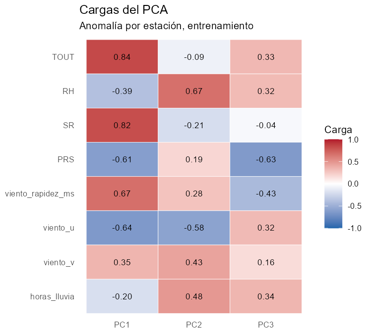
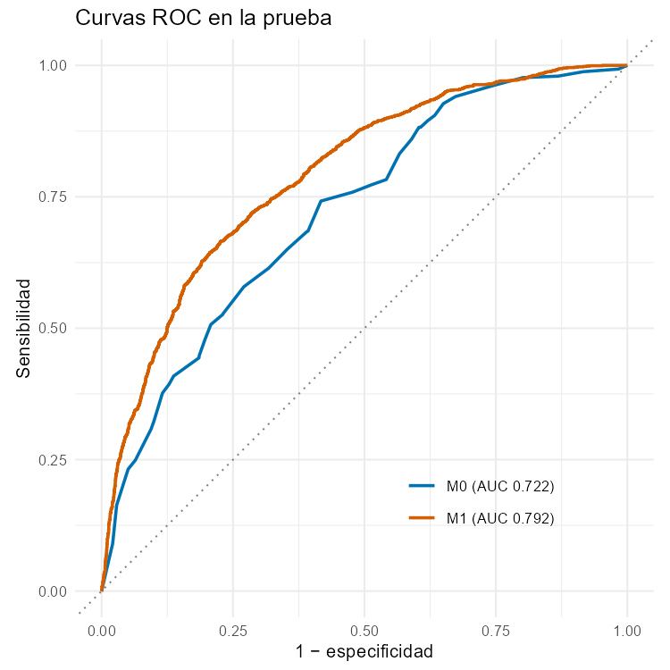
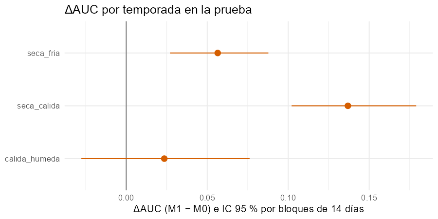
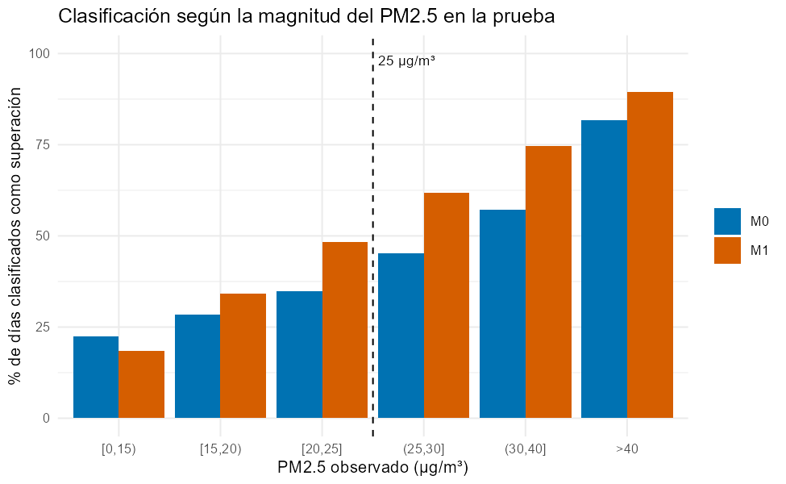
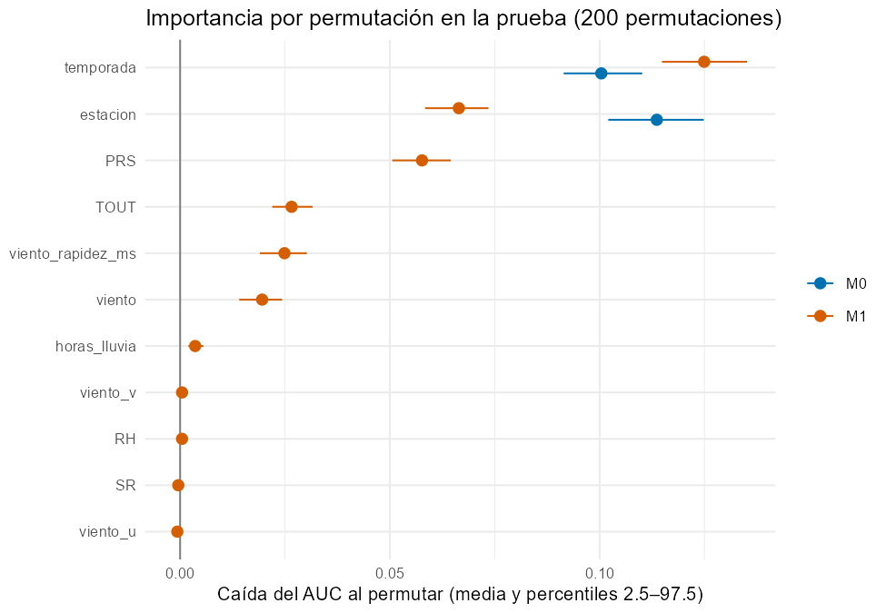
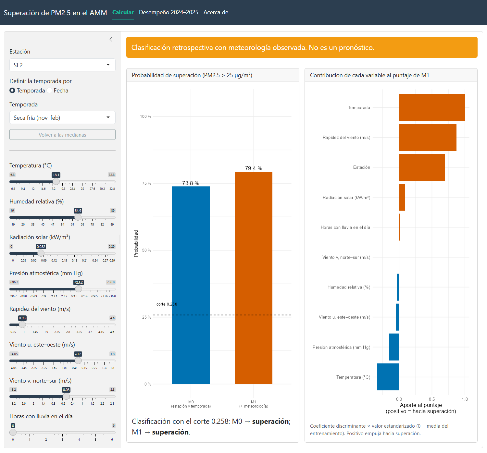

# Etapa 3. Modelado y evaluación

> **Borrador v2 (12 oct 2026).** Todas las cifras vienen de `output/etapa3/` (07a, 07b y 07c, verificadas). Límite: 10 páginas, con nombres y matrículas en la portada. La calibración, los errores por estación y los diagnósticos de instrumentos van como anexo complementario citado.

## 1. Objetivo del análisis (actualizado)

**Pregunta.** ¿En qué medida la meteorología del día mejora la clasificación retrospectiva de los días-estación con PM2.5 promedio de 24 h superior a 25 µg/m³, respecto de un modelo que solo considera la estación de monitoreo y la temporada, en 13 estaciones de la ZMM durante 2021–2025?

**Objetivo general (actualizado).** Cuantificar, con validación temporal, la mejora que aporta la meteorología del día (M1) sobre un modelo con estación y temporada (M0) para clasificar los días-estación con PM2.5 > 25 µg/m³, e identificar **en qué temporadas** y **con qué variables meteorológicas** se concentra esa mejora.

**Qué cambió respecto de la etapa 2.** La pregunta se mantiene. El objetivo se precisó en dos sentidos:
- La comparación por temporada pasó de descriptiva a objetivo, porque la exploración mostró que la superación depende mucho de la temporada.
- La presión se usa como anomalía de su estación, para separar la altitud del sitio de su efecto meteorológico (Sección 2).

Las decisiones de modelado se cerraron con validación progresiva en 2021–2023 **antes** de evaluar la prueba (commit `eb1946e`). La evaluación principal de 2024–2025 se hizo con las decisiones ya fijadas. Hubo una segunda corrida solo para corregir la presentación de una figura (cifras idénticas), y después se agregaron diagnósticos posteriores, declarados como tales. Esos años ya se habían usado en una prueba de viabilidad preliminar, declarada en el protocolo.

## 2. Datos y preparación para el modelado

**Muestra.** Usamos la base `datos-v1.2` de la etapa 2:
- **Unidad:** estación-día.
- **Cobertura:** 13 estaciones de SIMA (se excluyen NE3 y NO3 porque casi no miden PM2.5), de 2021 a 2025.
- **Criterio de inclusión:** PM2.5 diario con al menos 18 h válidas y las ocho variables meteorológicas con el mismo criterio.
- **Tamaño:** 15 390 estación-días.

**Variables.**
- **Respuesta:** `supera_25` = 1 si el PM2.5 diario es mayor de 25 µg/m³.
- **M0:** estación (13 categorías) y temporada: seca-fría (nov–feb), seca-cálida (mar–may) y cálida-húmeda (jun–oct).
- **M1:** M0 más temperatura (TOUT), humedad relativa (RH), radiación solar (SR), presión (PRS), componentes zonal (*u*) y meridional (*v*) del viento, rapidez del viento y horas con lluvia.

**Preparación.**
- **Limpieza horaria (etapas 1 y 2):**
  - Faltaba el 12.3 % de los valores horarios esperados de las 15 variables medidas en 2020–2025 (26.0 % en PM2.5). Las horas sin ningún registro son solo el 1.1 %.
  - Se invalidó el 0.7 % por lecturas inconsistentes: radiación nocturna, desviaciones frente a la red, rachas idénticas de 24 h, saltos y valores fuera de rango.
  - Se imputó el 1.0 %, solo huecos de hasta 3 h.
- **Partición temporal:**
  - entrenamiento 2021–2023: n = 10 170, 25.8 % de superación;
  - prueba 2024–2025: n = 5 220, 27.2 % de superación.
- **Escalado:** las variables se estandarizan con medias y desviaciones del entrenamiento.
- **Presión como anomalía (D17):** se usa la diferencia respecto de la media de su estación, calculada solo con el entrenamiento. Es una combinación lineal de la presión y de las indicadoras de estación, así que **no cambia el ajuste ni el AUC** (0.8286 en ambos casos en la validación). Lo que corrige es un efecto de supresión: con la presión cruda, los coeficientes de estación compensaban la altitud de cada sitio (la presión media va de 701 a 731 mm Hg según la estación).
- **Transformaciones (D16):** ninguna. En la validación progresiva, transformar a la vez la lluvia (log(1 + x)) y el viento (logaritmo) solo subió el AUC 0.003 y 0.007. Además, el logaritmo sobrecorregía la asimetría del viento (de +0.37 a −0.98). El logaritmo del viento queda como sensibilidad.
- **Cambios de instrumentos (información del socio formador).** SIMA informó (comunicación personal, 9 de octubre de 2026) dos cambios de equipo. En 2021 renovó los sensores de viento de todas las estaciones y los analizadores de gases. En 2025 instaló equipos nuevos de PM2.5 (Thermo 5014i) en SE2, NTE2, SUR, SO2 y NO. Esto tiene tres consecuencias:
  - **El viento de 2020 no es comparable.** En nuestros datos su nivel cambia entre marzo y abril de 2021; por ejemplo, la mediana mensual de SE3 pasa de 0.96 m/s en marzo a 2.74 m/s en abril. Esto respalda haber excluido 2020 del modelado.
  - **Las lecturas sospechosas de viento de SO2 (junio–octubre de 2021)** ocurrieron el mismo año de la renovación. Sin las fechas de instalación no podemos relacionarlas directamente.
  - **El cambio de equipo de PM2.5 cae dentro del año de prueba.** Por eso se agregaron diagnósticos posteriores, declarados como tales, que no cambian el modelo principal (Anexo A3):
    - La mejora es parecida en 2024 (ΔAUC 0.066 [0.033, 0.097]) y en 2025 (0.078 [0.045, 0.124]).
    - En las 5 estaciones con equipo nuevo, en 2025 la mejora no disminuye (0.098 [0.063, 0.143]).
    - Una sensibilidad exploratoria que entrena solo desde abril de 2021, cuando cambia el nivel del viento en la mayoría de las estaciones, da 0.067 [0.045, 0.091].
    - No hay señal de que los cambios de instrumentos alteren la conclusión.

## 3. Técnicas y justificación

| Técnica | Tipo | Papel en el objetivo | Justificación |
|---|---|---|---|
| Componentes principales (PCA) | Interdependencia | Describir la estructura de correlación de las 8 variables meteorológicas | Hay colinealidad (ρ = −0.61 entre *u* y la rapidez; 0.53 entre TOUT y SR). El PCA identifica los ejes meteorológicos que el LDA combina |
| Análisis discriminante lineal (LDA) | Dependencia | Técnica principal: M0 frente a M1 | Produce una función lineal interpretable que separa los días con y sin superación. Es un precedente en redes de monitoreo (Mohd Shafi'i & Juahir, 2024) |
| Regresión logística | Dependencia | Solo robustez | No supone normalidad ni covarianzas iguales; verifica que la conclusión no dependa del LDA |

**Validación.**
- **Métrica principal:** AUC en la prueba. Además, exactitud balanceada, sensibilidad, especificidad y puntaje de Brier (Brier, 1950; Fawcett, 2006).
- **Punto de corte:** la prevalencia del entrenamiento (0.258).
- **Incertidumbre:** bootstrap pareado por bloques de 14 días consecutivos, que mantienen juntas todas las estaciones de esas fechas (1 000 réplicas; Künsch, 1989). Un episodio de partículas afecta a varias estaciones y dura varios días, así que remuestrear días sueltos subestimaría la incertidumbre (Sección 4.5).

## 4. Resultados

### 4.1 Estructura de la meteorología (PCA)

Se ajustó con las anomalías por estación del entrenamiento.
- **Adecuación:** KMO de 0.65 y prueba de Bartlett significativa (χ² = 24 798, gl = 28, p < 0.001).
- **Componentes:** tres valores propios mayores de 1 (2.92, 1.36 y 1.04; criterio de Kaiser, 1960), que explican el 67 % de la varianza.

Lectura de las cargas (Figura 1):
- **PC1 (36 %), «día cálido, soleado y ventilado»:** TOUT 0.84, SR 0.82, rapidez 0.67, PRS −0.61, *u* −0.64 (más flujo del este).
- **PC2 (17 %), «día húmedo y lluvioso»:** RH 0.67, lluvia 0.48, *v* 0.43, *u* −0.58.
- **PC3 (13 %), «presión baja y poco viento»:** PRS −0.63, rapidez −0.43, TOUT 0.33, lluvia 0.34.

**Interpretación.** PC1 junta en un mismo eje variables que se asocian con la superación en sentidos contrarios: dentro de cada temporada, más temperatura se asocia con más superaciones y más viento con menos (Sección 4.4). Maximizar la varianza no maximiza la separación entre clases, y por eso el PCA es exploratorio. Aun así, usar PC1–PC3 en lugar de las 8 variables casi no pierde desempeño (AUC 0.786 frente a 0.792; Tabla 2). La información meteorológica útil está concentrada en pocos ejes.

**Figura 1.** Cargas de los tres primeros componentes (anomalías por estación, entrenamiento 2021–2023).

### 4.2 Desempeño de M0 y M1 en la prueba (2024–2025)

**Tabla 1.** Desempeño en la prueba (n = 5 220; 27.2 % de superación). IC del 95 % por bootstrap de bloques de 14 días.

| Métrica | M0 (estación + temporada) | M1 (+ meteorología) | M1 − M0 [IC 95 %] |
|---|---|---|---|
| AUC | 0.722 | 0.792 | **+0.070 [0.047, 0.094]** |
| Exactitud balanceada | 0.654 | 0.715 | +0.061 [0.033, 0.086] |
| Sensibilidad | 0.579 | 0.730 | +0.151 |
| Especificidad | 0.729 | 0.700 | −0.029 |
| Puntaje de Brier | 0.175 | 0.156 | −0.019 |

- **La mejora es clara.** El intervalo de ΔAUC no incluye el cero; en las 1 000 réplicas, ΔAUC va de 0.036 a 0.111. Además, es parecida a la mejora de la validación progresiva (+0.066 en 2022 y +0.080 en 2023). Eso indica que la mejora es estable y no un efecto del año de prueba.
- **Qué significa en la práctica.** M1 detecta el **73 %** de los días con superación, contra el **58 %** de M0, a cambio de una pequeña pérdida de especificidad (de 0.73 a 0.70). Si para la vigilancia no detectar un episodio cuesta más que una falsa alarma, ese intercambio favorece a M1. Valorar esos costos corresponde a SIMA; este estudio no los cuantifica.
- **Calibración.** El Brier menor de M1 indica mejores probabilidades, aunque el Brier combina calibración y discriminación. La recalibración (logística de la superación observada sobre logit(p)) da una pendiente de 0.76 en M0 y en M1, cuando el ideal es 1: las probabilidades son algo extremas. Por ejemplo, en el decil más alto M1 predice 0.81 y se observa 0.72 (Anexo A1). Una recalibración (transformación creciente de las probabilidades) no cambia el AUC, pero con el mismo corte numérico sí cambia algunas clasificaciones: 70 de 5 220 en la prueba. Para comunicar probabilidades a SIMA habría que recalibrar con el entrenamiento y ajustar el corte en consecuencia.
- **Lectura correcta del AUC.** Un AUC de 0.79 no significa 79 % de aciertos. Es la probabilidad de que un día con superación reciba un puntaje mayor que uno sin superación.

 
**Figura 2.** (a) Curvas ROC de M0 y M1 en la prueba. (b) ΔAUC por temporada con IC del 95 %.

**Por temporada (Figura 2b):**

| Temporada | n | % de superación | ΔAUC [IC 95 %] |
|---|---|---|---|
| Seca-cálida | 1 333 | 42 % | +0.137 [0.102, 0.179] |
| Seca-fría | 1 817 | 35 % | +0.056 [0.027, 0.088] |
| Cálida-húmeda | 2 070 | 10 % | +0.023 [−0.028, 0.076] |

En la temporada de lluvias la mejora no es distinguible de cero. En seca-cálida es donde la meteorología más ayuda: en esa época el riesgo depende menos de la temporada en sí y más de las condiciones de cada día.

### 4.3 Análisis de errores

**Matriz de confusión de M1** (corte 0.258):

| | Clasificado con superación | Clasificado sin superación |
|---|---|---|
| **Con superación (1 418)** | 1 035 (VP) | 383 (FN) |
| **Sin superación (3 802)** | 1 139 (FP) | 2 663 (VN) |

- **Superaciones no detectadas:** M1 deja sin detectar el 27 %, contra el 42 % de M0.
- **Falsas alarmas:** M1 marca como superación el 30 % de los días limpios, contra el 27 % de M0.

**Los errores se concentran cerca del umbral (Figura 3):**
- Por arriba del umbral, M1 detecta el 62 % de los días con 25–30 µg/m³, el 75 % con 30–40 y el **89 % de los episodios mayores de 40 µg/m³** (M0: 82 %).
- Por debajo, las falsas alarmas se acumulan en los días con 20–25 µg/m³: M1 marca como superación el 48 %.
- En los días limpios (< 15 µg/m³), M1 comete **menos** falsas alarmas que M0 (18.5 % frente a 22.4 %).

M1 mejora en los dos extremos. Lo que no resuelve son los días cercanos a 25 µg/m³, donde la frontera es difícil por naturaleza: una diferencia de pocos µg/m³ cambia la clase.

**Por temporada:**
- **Seca-cálida:** M1 sube la sensibilidad de 0.51 a 0.75, a cambio de especificidad (de 0.64 a 0.59).
- **Seca-fría:** detecta el 86 % de las superaciones, pero con muchas falsas alarmas (especificidad 0.49).
- **Cálida-húmeda:** es el punto débil. La sensibilidad de M1 es 0.32, sin mejora sobre M0 (0.35). Las superaciones en lluvias son raras (10 %) y las variables disponibles no las distinguen.

**Por estación (Anexo A2):** con un solo corte para toda la red, el modelo sobrealerta donde la prevalencia es alta y subdetecta donde es baja:
- especificidad de 0.21 en SE2 y 0.34 en SO;
- sensibilidad de 0.27 en SUR, 0.23 en NO2 y 0.39 en SO2.

M0 es todavía más extremo: en varias estaciones clasifica todos los días de una temporada igual, con sensibilidad 0 o 1. Cortes específicos por estación, elegidos con el entrenamiento, son una mejora natural para un uso operativo.

**Figura 3.** Porcentaje de días clasificados como superación según la magnitud del PM2.5, para M0 y M1 (prueba 2024–2025). Por debajo de 25 µg/m³ corresponde a falsas alarmas y por encima a detecciones.

### 4.4 Variables más importantes

**M1, función discriminante** (coeficientes estandarizados divididos entre el máximo y correlaciones de estructura; se interpretan en conjunto):
- **Temporada seca-fría:** 1.00; estructura 0.38.
- **Rapidez del viento:** −0.60; estructura −0.52.
- **Presión (anomalía):** −0.59; estructura −0.36.
- **Temporada seca-cálida:** 0.54.
- **Estación SUR:** −0.47.
- **Temperatura:** 0.44; estructura −0.06.

Entre las variables meteorológicas, **el viento y la presión son las más importantes**: menos ventilación y presión más baja de lo normal se asocian con superación. La temperatura tiene un coeficiente positivo pero una correlación de estructura casi nula. Por sí sola no separa las clases, porque los días fríos también son de la temporada con más superaciones; condicionada a la temporada, en cambio, los días más cálidos tienen más superaciones. Es el mismo patrón de tipo Simpson que se observó en la etapa 2.

**Importancia por permutación en la prueba** (caída del AUC al desordenar una variable, 200 permutaciones; Breiman, 2001; Figura 4):

| Variable | Caída del AUC [P2.5–P97.5] |
|---|---|
| Temporada | 0.125 [0.115–0.135] |
| Estación | 0.066 [0.058–0.074] |
| Presión (anomalía) | 0.058 [0.051–0.065] |
| Temperatura | 0.027 [0.022–0.032] |
| Rapidez del viento | 0.025 [0.019–0.030] |
| Horas con lluvia | 0.004 [0.002–0.006] |
| Humedad, radiación, *u* y *v* | ≈ 0 |

Los dos métodos coinciden: **las variables meteorológicas que importan son la presión, la temperatura y la rapidez del viento**; la lluvia aporta poco y las demás casi nada. Dos precisiones:
- La presión está centrada solo por estación, así que conserva su ciclo estacional, y parte de su importancia se comparte con la temporada.
- Con predictores correlacionados, la permutación individual puede repartir mal la importancia (Strobl et al., 2008). Por eso también se permutó el grupo «viento» (*u*, *v* y rapidez juntos), con una caída de 0.020.

**Figura 4.** Importancia por permutación en la prueba (caída media del AUC e intervalo de percentiles 2.5–97.5).

**M0.** La estación y la temporada pesan parecido: caídas del AUC de 0.114 y 0.100. Las estaciones con más superación (SE2 y SO) y con menos (SUR y SE) concentran los coeficientes de estación.

### 4.5 Supuestos y su tratamiento

**Tabla 3.** Supuestos verificados y su tratamiento.

| Supuesto | Verificación | Resultado | Tratamiento |
|---|---|---|---|
| Normalidad multivariada por clase (LDA) | Asimetría por clase; prueba de Mardia | No se cumple. Mardia rechaza en ambas clases (asimetría χ² = 85 936 y 206 313, gl = 120; p < 0.001). La lluvia tiene asimetría de 7.2 y 21.1 (94 % de días en cero), y las indicadoras no son normales por definición | El LDA se usa como clasificador lineal. La logística, que no supone normalidad, da la misma conclusión (ΔAUC 0.060 [0.039, 0.082]) |
| Covarianzas iguales entre clases | M de Box (Box, 1949) y razón de desviaciones estándar | Rechazada con las ocho variables meteorológicas del modelo final, con la presión como anomalía (χ² = 3 530, gl = 36, p < 0.001). El valor p debe leerse con cautela por la falta de normalidad, la dependencia y el n grande. La diferencia se concentra en la lluvia (razón de desviaciones 0.38); en lo demás, 0.81–1.08 | Igual que el anterior; se reporta |
| Multicolinealidad | Correlaciones, VIF y número de condición | *u* y rapidez ρ = −0.61; VIF máximo de 2.14 (TOUT); número de condición de 3.03: colinealidad baja | Coeficientes interpretados en conjunto; presión como anomalía; sensibilidad con PCs (Tabla 2) |
| Independencia | Autocorrelación del residuo de M1 por estación; correlación entre estaciones el mismo día | No se cumple. La autocorrelación es de 0.44 a 1 día y de 0.10 a 14 días; la correlación entre estaciones el mismo día es de 0.38 | Bootstrap por bloques de 14 días con todas las estaciones. Con bloques de 28 días, el IC sigue sin incluir el cero [0.041, 0.100] |
| Especificación de estación y temporada | Sensibilidad con interacción estación × temporada | ΔAUC 0.056 [0.036, 0.076] | La conclusión se mantiene. La linealidad de las variables meteorológicas no se evaluó directamente (pendiente: términos no lineales) |
| Adecuación del PCA | KMO y Bartlett | KMO 0.65; Bartlett p < 0.001 | Adecuado; se usa como exploratorio |

### 4.6 Robustez y sensibilidades

**Tabla 2.** ΔAUC (M1 − M0) en la prueba según el análisis.

| Análisis | AUC M0 | AUC M1 | ΔAUC [IC 95 %] |
|---|---|---|---|
| Principal (LDA, bloques de 14 días) | 0.722 | 0.792 | 0.070 [0.047, 0.094] |
| Regresión logística | 0.734 | 0.794 | 0.060 [0.039, 0.082] |
| Bloques de 7 / 28 días | 0.722 | 0.792 | [0.047, 0.093] / [0.041, 0.100] |
| Umbral de 15 µg/m³ (guía OMS) | 0.681 | 0.774 | 0.093 [0.069, 0.118] |
| PM2.5 solo con horas observadas (n = 4 978) | 0.716 | 0.790 | 0.074 [0.051, 0.098] |
| M1 con PC1–PC3 | 0.722 | 0.786 | 0.064 [0.039, 0.090] |
| Interacción estación × temporada | 0.741 | 0.797 | 0.056 [0.036, 0.076] |
| Logaritmo de la rapidez del viento | 0.722 | 0.795 | 0.074 [0.048, 0.099] |

La mejora se mantiene entre +0.056 y +0.093 en todos los análisis. Además, M0 estimado en la muestra amplia con solo PM2.5 válido (prueba n = 7 250) da un AUC de 0.706 [0.669, 0.741], cercano al de la muestra principal (0.722). Como las poblaciones de prueba son distintas, esto no descarta un sesgo de selección, pero no sugiere que la referencia esté fuertemente inflada.

### 4.7 Interfaz para usar el modelo

La aplicación Shiny (`app/`; se ejecuta con `shiny::runApp("app")`) tiene tres pestañas (Figura 5):
- **«Calcular»:** se eligen estación, temporada o fecha, y los valores de las 8 variables meteorológicas. Muestra la probabilidad de superación según M0 y M1, la clasificación con el corte del modelo y la contribución de cada variable al puntaje discriminante.
- **«Desempeño 2024–2025»:** métricas y serie de tiempo con falsos negativos y falsos positivos por estación y temporada.
- **«Acerca de»:** datos, modelo y limitaciones.

**Validación de la app.** Una prueba automática (`tests/test_app_predicciones.R`) comprueba tres cosas:
- reproduce exactamente las predicciones del análisis en 20 filas aleatorias de la prueba (error 0);
- en 9 984 combinaciones de entradas extremas da probabilidades válidas;
- el servidor responde en todos los casos.

La app advierte que la clasificación es retrospectiva, con meteorología observada, y no un pronóstico.

**Figura 5.** Pestaña «Calcular» de la interfaz.

## 5. Discusión

**Interpretación sustantiva.** Saber qué estación y qué temporada son ya separa buena parte de los días con superación (AUC 0.72). La meteorología del día agrega información estable a la clasificación retrospectiva (+0.07). Esa información viene sobre todo de:
- **la presión baja** respecto de lo normal en el sitio;
- **la temperatura**, una vez fijada la temporada;
- **la ventilación**: menor rapidez del viento.

Es coherente con la acumulación de partículas en condiciones de viento débil documentada en la ZMM (Martínez-Cinco et al., 2016) y con la persistencia de episodios en la temporada seca (Hernández-Romero et al., 2026). La combinación de presión baja y temperatura alta sugiere condiciones previas al paso de frentes, que es una hipótesis por verificar con datos sinópticos.

**Para SIMA.**
- La meteorología sirve más en **marzo–mayo**, cuando el riesgo varía de un día a otro.
- En la temporada de lluvias las superaciones son raras y difíciles de clasificar con estas variables.
- Los episodios graves (> 40 µg/m³) se detectan en el 89 % de los casos; los errores se concentran cerca del umbral.
- Un mismo corte para toda la red sobrealerta en SE2 y SO y subdetecta en SUR y NO2. Para un uso operativo convendrían cortes por estación.
- Las pruebas de consistencia que agregamos (radiación nocturna y viento frente a la red) detectaron lecturas sospechosas de sensores; estas pruebas podrían incorporarse a su control de calidad.

**Limitaciones.**
1. **Es retrospectivo:** usa la meteorología observada del mismo día. Para una alerta se necesita meteorología pronosticada, cuyo error reduciría la mejora.
2. **La muestra no es aleatoria:** la retención va de 28 % (NO2) a 96 % (NTE2).
3. **Hay dependencia** entre días y estaciones. Se trató con el bootstrap por bloques, pero los errores estándar de los coeficientes no la consideran.
4. **No hay altura de capa de mezcla** ni información de emisiones.
5. **Hubo cambios de instrumentos** (viento en 2021, PM2.5 en 5 estaciones en 2025), que pueden introducir saltos en las series. Los diagnósticos no muestran que alteren la conclusión (Sección 2), pero falta confirmar con SIMA las fechas de instalación.
6. **El umbral de 25 µg/m³ es una referencia fija**, no una evaluación normativa.
7. **La prueba 2024–2025 ya se usó en un ensayo preliminar.** Las decisiones se cerraron con 2021–2023 y la mejora coincide con la de la validación progresiva.
8. **Las probabilidades no están calibradas** (pendiente 0.76) y el corte es único para toda la red.

## 6. Conclusión parcial

**Logros.**
- Base limpia y documentada (`datos-v1.2`) con pruebas automáticas.
- Protocolo con decisiones cerradas antes de evaluar.
- Dos técnicas multivariadas (PCA y LDA) con validación temporal y robustez.
- Interfaz para usar el modelo.

**Resultados.** La meteorología mejora la clasificación de días con PM2.5 > 25 µg/m³ en +0.07 de AUC [0.05, 0.09] y eleva la detección del 58 % al 73 %. La mejora se concentra en la temporada seca-cálida, y el viento y la presión son sus variables principales.

**Pendientes.**
- Integrar el informe final.
- Cerrar la revisión del código.
- Preparar la exposición con SIMA.

**Plan.**
- Evaluar el modelo con meteorología pronosticada.
- Agregar la persistencia (PM2.5 del día anterior).
- Recalibrar las probabilidades y definir cortes por estación con el entrenamiento.
- Discutir con SIMA el contexto de las estaciones con más superaciones (SE2 y SO).

**Preguntas surgidas.**
- ¿La mejora se conserva con pronóstico meteorológico?
- ¿Qué fuentes locales explican las diferencias entre estaciones?
- ¿Por qué la meteorología casi no ayuda en temporada de lluvias?
- ¿Hay grupos de estaciones con sensibilidad meteorológica similar?
- ¿En qué fechas exactas cambiaron los equipos de viento (2021) y de PM2.5 (2025), y hubo periodos de comparación entre equipos viejos y nuevos?

**Repositorio:** https://github.com/Leo-issacs/reto-sima-multivariados (scripts `07a`–`07c`, `app/`, `output/etapa3/`).

## Referencias (verificar antes de entregar)

Box, G. E. P. (1949). A general distribution theory for a class of likelihood criteria. *Biometrika, 36*(3/4), 317–346. https://doi.org/10.1093/biomet/36.3-4.317

Breiman, L. (2001). Random forests. *Machine Learning, 45*(1), 5–32. https://doi.org/10.1023/A:1010933404324

Brier, G. W. (1950). Verification of forecasts expressed in terms of probability. *Monthly Weather Review, 78*(1), 1–3. https://doi.org/10.1175/1520-0493(1950)078<0001:VOFEIT>2.0.CO;2

Fawcett, T. (2006). An introduction to ROC analysis. *Pattern Recognition Letters, 27*(8), 861–874. https://doi.org/10.1016/j.patrec.2005.10.010

Hernández-Romero, K., Hernández-Romero, I. M., Mendoza, A., Pérez-Rodríguez, M., Barajas-Villarruel, L. R., Medellín-Carrillo, S., & González, L. T. (2026). Persistent air pollution regimes and regulatory exceedances of PM10, PM2.5, and O3 in the Monterrey Metropolitan Area, Mexico. *City and Environment Interactions, 31*, 100410. https://doi.org/10.1016/j.cacint.2026.100410

Johnson, R. A., & Wichern, D. W. (2007). *Applied multivariate statistical analysis* (6th ed.). Pearson.

Kaiser, H. F. (1960). The application of electronic computers to factor analysis. *Educational and Psychological Measurement, 20*(1), 141–151. https://doi.org/10.1177/001316446002000116

Künsch, H. R. (1989). The jackknife and the bootstrap for general stationary observations. *The Annals of Statistics, 17*(3), 1217–1241. https://doi.org/10.1214/aos/1176347265

Martínez-Cinco, M. A., Santos-Guzmán, J., & Mejía-Velázquez, G. M. (2016). Source apportionment of PM2.5 for supporting control strategies in the Monterrey Metropolitan Area, Mexico. *Journal of the Air & Waste Management Association, 66*(6), 631–642. https://doi.org/10.1080/10962247.2016.1159259

Mohd Shafi'i, M. S., & Juahir, H. (2024). Assessment of spatial air quality on the East Coast of Peninsular Malaysia utilizing environmetric techniques. *Environmental Monitoring and Assessment, 196*(7), 640. https://doi.org/10.1007/s10661-024-12787-9

Strobl, C., Boulesteix, A.-L., Kneib, T., Augustin, T., & Zeileis, A. (2008). Conditional variable importance for random forests. *BMC Bioinformatics, 9*, 307. https://doi.org/10.1186/1471-2105-9-307

## Anexo A. Información complementaria (citada en el texto)

- **A1. Calibración por deciles** (`output/etapa3/figuras/calibracion.png` y `diagnostico/calibracion_deciles.csv`).
- **A2. Errores por estación** (`diagnostico/errores_por_estacion.csv` y `figuras/errores_temporada_estacion.png`).
- **A3. Diagnósticos por cambios de instrumentos:** viento mensual 2020–2025 (`figuras/viento_mensual_2020_2025.png`), desempeño por año y por grupo de estaciones, y sensibilidad con entrenamiento desde abril de 2021.

## Anexo B. Declaratoria de uso de IA (Opción B)

- **Herramientas:** Claude (Anthropic): Claude Opus y Claude Code; Codex (OpenAI); [agregar las IA que usaron los demás integrantes].
- **Uso realizado:**
  - Claude Opus: validación progresiva exploratoria, decisiones de modelado, redacción del informe y de la guía del equipo.
  - Claude Code: scripts de R `07a`–`07c`, figuras e interfaz Shiny.
  - Codex: revisión independiente del código y de las cifras.
  - [Pablo, Ignacio y Daniel: qué IA usaron y para qué.]
- **Secciones:** todo el informe, scripts `07a`–`07c` y `app/`.
- **Validación realizada por los estudiantes:** [COMPLETAR con lo que de verdad revisó cada quien].
- Confirmamos que revisamos y verificamos el contenido final y asumimos la responsabilidad sobre él.
