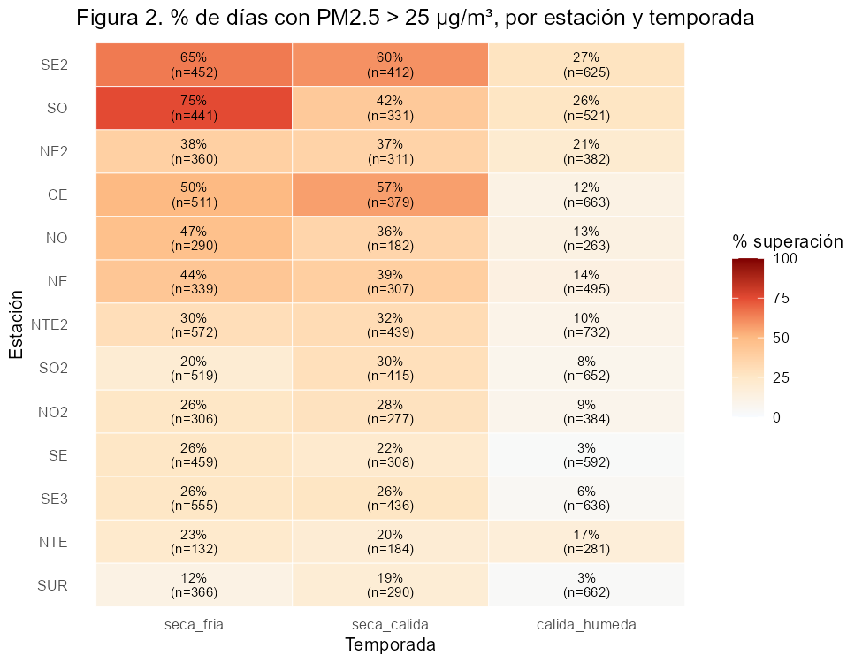
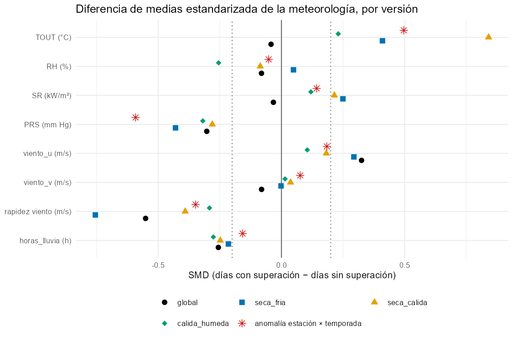
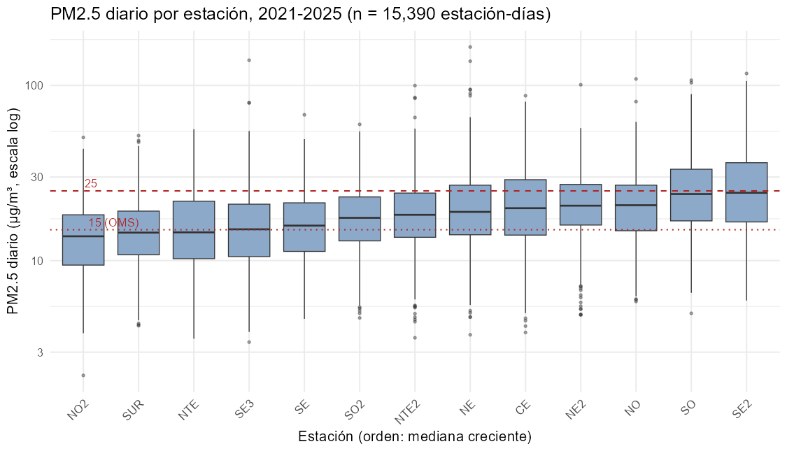
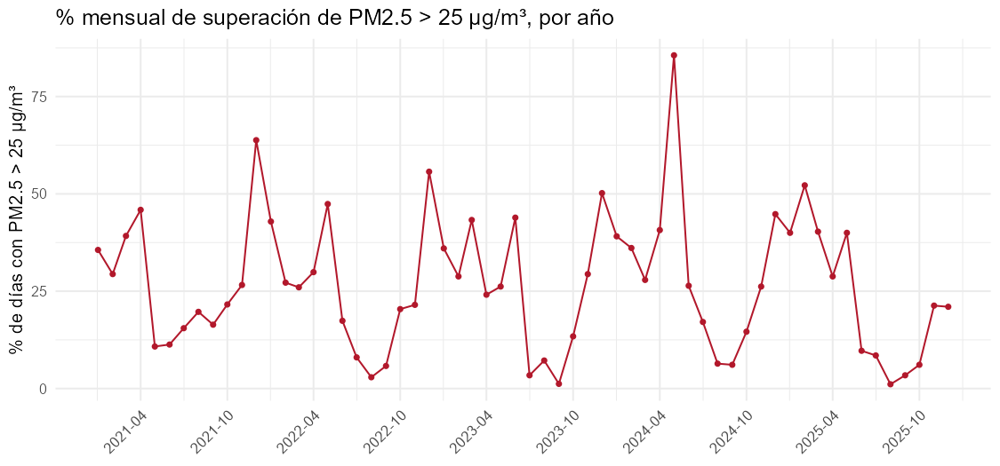
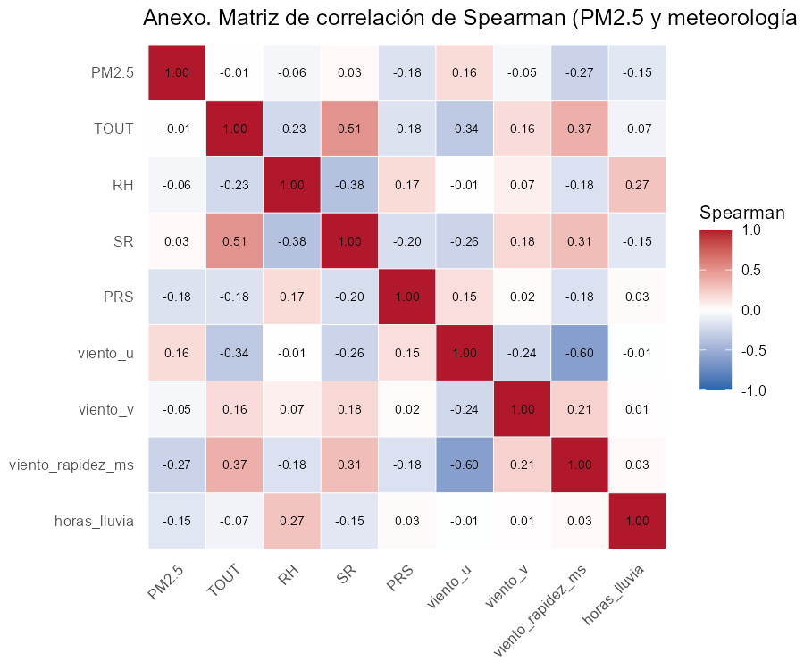

```{r}
#| label: setup
suppressPackageStartupMessages({
  library(data.table)
  library(knitr)
})
E2 <- "output/etapa2/"
miles <- function(x) formatC(x, format = "d", big.mark = " ")
```

::: {custom-style="Subtitle"}
Leonardo Orozco · Pablo Alonso Robles Nava · Daniel Ayala · Ignacio Kume

8 de octubre de 2026

Análisis multivariado (MA2003B) · Grupo 201 · Equipo 1

Repositorio de GitHub: https://github.com/Leo-issacs/reto-sima-multivariados
:::




# 1. Objetivo de indagación

En la etapa 1 propusimos identificar regímenes multicontaminante mediante conglomerados. Tras la retroalimentación de los profesores, acotamos el objetivo a PM2.5 para completar el análisis en las tres semanas restantes. Conservamos el periodo 2021–2025 y las temporadas definidas, y actualizamos la limpieza con los hallazgos de esta etapa. La elección de PM2.5 se apoya en la evidencia de su asociación con mortalidad por exposición de corto plazo (Orellano et al., 2020; World Health Organization [WHO], 2021) y en los episodios documentados en la ZMM (Hernández-Romero et al., 2026).

**Pregunta.** ¿En qué medida la meteorología del día mejora la clasificación retrospectiva de los días-estación con PM2.5 promedio de 24 h superior a 25 µg/m³, respecto de un modelo que solo considera la estación de monitoreo y la temporada, en 13 estaciones de la ZMM durante 2021–2025?

**Objetivo general.** Comparar mediante validación temporal dos modelos de análisis discriminante lineal (LDA): M0, con estación y temporada, y M1, que añade ocho variables meteorológicas. Se evaluarán la diferencia de AUC (ΔAUC) y de exactitud balanceada, con incertidumbre estimada por bootstrap. **Objetivos específicos:** describir las superaciones y sus diferencias meteorológicas en esta etapa; estimar M0, M1 y su diferencia de desempeño en la etapa 3.

**Sobre el umbral.** 25 µg/m³ es el límite de 24 h del quinto año de aplicación de la NOM-025-SSA1-2021 (Secretaría de Salud, 2021). Lo usamos como referencia fija para todo el periodo, no como evaluación del cumplimiento histórico, porque los límites vigentes cambiaron entre 2021 y 2025. El resultado describe concentraciones, no riesgo individual: por debajo de 25 µg/m³ el riesgo no es nulo (WHO, 2021).

# 2. Ruta de análisis

El protocolo (`docs/etapa2/protocolo.md`, v3) fija la comparación antes del ajuste definitivo. Declara una prueba preliminar que ya utilizó 2024–2025; por ello, estos años no constituyen una evaluación completamente ajena a la exploración previa. Las decisiones restantes se tomarán con validación progresiva en 2021–2023. La @tbl-ruta resume la ruta.

| Técnica (etapa) | Rol | Justificación |
|---|---|---|
| Proporciones, SMD y Spearman (2) | Describir superaciones y asociaciones | Diferencias estandarizadas y asociaciones monotónicas (Austin, 2009) |
| Componentes principales (3) | Explorar la estructura meteorológica | Resume correlaciones; no garantiza separar clases |
| LDA, M0 frente a M1 (3) | Técnica principal | Precedente ambiental y supuestos por revisar (Mohd Shafi'i & Juahir, 2024; Johnson & Wichern, 2007) |
| Regresión logística (3) | Solo robustez | Verifica que la conclusión no dependa del LDA |
| Validación temporal y bootstrap de 14 días (3) | Desempeño fuera de muestra e incertidumbre | Entrenar 2021–2023; evaluar 2024–2025. Remuestrear bloques con todas las estaciones |

: Ruta de análisis. {#tbl-ruta}

**Variables.** La respuesta binaria `supera_25` indica si el PM2.5 diario supera 25 µg/m³. M0 incluye dos variables categóricas: estación (13 categorías) y temporada, definida como seca-fría (nov–feb), seca-cálida (mar–may) y cálida-húmeda (jun–oct). M1 añade temperatura (TOUT, °C), humedad relativa (RH, %), radiación solar (SR, kW/m²), presión (PRS, mm Hg), componentes *u* y *v* y rapidez del viento (m/s), y número de horas con lluvia (0–24). Las primeras siete son cuantitativas continuas; la última es un conteo. El año define la partición temporal. Los demás contaminantes quedan fuera para centrar la comparación en la meteorología; *u* y *v* representan la dirección del viento sin discontinuidad angular. No usamos la cantidad de lluvia porque su unidad no está confirmada.

# 3. Datos y papel de la estación

Cada registro corresponde a una estación en un día. Partimos de una base diaria de 31 783 registros y 40 columnas (2020–2025). Para el análisis seleccionamos 2021–2025 y excluimos NE3 y NO3 por su escasa cobertura de PM2.5. Exigimos al menos 18 horas válidas por variable, incluidas las imputadas. De 23 738 registros candidatos quedan 15 390 (64.8 %), sin faltantes en la respuesta ni en los ocho predictores. Se excluyen 3 820 por PM2.5 y 5 763 por meteorología; 1 235 incumplen ambos requisitos y están contados en los dos grupos (Anexo A1). En respuesta a la retroalimentación de la etapa 1, el Anexo C presenta el diccionario completo de las bases horaria (39 columnas), diaria (40) y de la muestra (24), con tipo, dominio y porcentaje de nulos antes y después de la limpieza.

La estación permite representar diferencias persistentes entre sitios, sin identificar por separado sus causas. La presión media varía de unos 701 a 731 mm Hg; por ello también examinamos desviaciones respecto de la media de cada estación y temporada. La retención va de 28.0 % en NO2 a 95.5 % en NTE2. Aquí NO2 es el código de una estación, no el contaminante NO2. Exigir meteorología completa cambia poco la proporción global de superaciones de PM2.5 (25.7 % a 26.3 %), pero en esa estación la reduce de 18.2 % a 10.0 %. Entre sus días con PM2.5 válido, la proporción es 24.6 % sin radiación válida y 8.5 % con ella. Esta selección motiva evaluar M0 también en los 19 918 registros con solo PM2.5 válido.

**Hallazgo de calidad y regla nueva.** Detectamos lecturas sospechosas: promedios diarios de viento de hasta 33 m/s en SO2 y NE2 (2021), cuando la mediana horaria de la red rondaba 10 km/h, y radiación solar de hasta 1.4 kW/m² entre las 00 y las 04 h, sobre todo en NO2, SE3 y CE. La regla D15 añade pruebas de consistencia inspiradas en Estévez et al. (2011) y Fiebrich et al. (2010), con umbrales elegidos por el equipo: se invalida la radiación de todo el día si su media entre 00 y 04 h supera 0.02 kW/m², con al menos tres lecturas. Se invalida el viento horario si supera en más de 30 km/h la mediana de la red, con al menos cinco estaciones; tres o más horas marcadas invalidan todo el día. Estas horas no se imputan. El diagnóstico identifica 1 071 registros excluidos por D15 (Anexo A6); el viento diario máximo de la muestra queda en 7.3 m/s. El horario local se mantiene como supuesto pendiente de confirmación con SIMA.

**Sensibilidad a la imputación.** Al exigir al menos 18 horas observadas de PM2.5, sin imputación, 429 registros (2.8 %) dejan de ser evaluables. Entre los 14 961 comparables, 101 (0.7 %) cambian de clase. La clasificación cambia poco en ese subconjunto, aunque no puede evaluarse de la misma manera en los días que pierden cobertura.

# 4. Exploración descriptiva

## 4.1 Distribución de las superaciones

El 26.3 % de los estación-días supera 25 µg/m³. La mediana del PM2.5 diario es 18.2 µg/m³, con asimetría positiva (2.0) y episodios de hasta 166 µg/m³ (Anexo A2). La superación es más frecuente en seca-fría (37.2 %) y seca-cálida (35.5 %) que en cálida-húmeda (12.4 %). Como antecedente local, Martínez-Cinco et al. (2016), en campañas de otoño de 2007 y verano de 2008, relacionan la acumulación otoñal de partículas con viento débil y menor altura de mezcla. Nuestro análisis no mide esta última. La proporción anual oscila entre 24.0 % y 29.7 %, sin un patrón monotónico en los cinco años (Anexo A3). La @fig-superacion muestra un gradiente espacial amplio: SE2 y SO superan en casi la mitad de sus días y SUR en menos del 10 %. El patrón estacional, además, cambia según la estación: SO pasa de 75 % en seca-fría a 42 % en seca-cálida, CE alcanza su máximo en seca-cálida (55 %) y NTE casi no varía (17–23 %).

*Interpretación.* Las diferencias entre estaciones y temporadas justifican incluir ambas en M0; su capacidad de clasificación aún debe evaluarse. Como el patrón estacional varía entre sitios, el protocolo incorpora una comparación adicional con interacción estación × temporada.

{#fig-superacion width="4.6in"}

## 4.2 Meteorología de los días con superación

La @fig-smd compara las clases mediante la diferencia de medias estandarizada (SMD): global, por temporada y en anomalías (valor menos la media de su estación y temporada). El centrado reduce las diferencias de nivel entre estación y temporada, pero sigue siendo una comparación descriptiva: no estima por sí solo la mejora de M1 frente a M0.

- **Temperatura.** La diferencia global es casi nula (SMD −0.04), mientras que en cada temporada es positiva (0.23 a 0.84); en las anomalías alcanza 0.50. Este cambio de signo al agrupar es compatible con un patrón de Simpson y muestra por qué conviene comparar por temporada. Las correlaciones globales con PM2.5 son débiles (|ρ| ≤ 0.27; Anexo A4).
- **Viento.** Los días con superación presentan menor rapidez (SMD −0.55 global; −0.35 en anomalías; −0.75 en seca-fría). El resultado es compatible con menor ventilación, aunque no permite atribuirle por sí solo los episodios de PM2.5.
- **Presión.** Presenta el mayor contraste en anomalías (SMD −0.59): los días con superación tienen presión inferior al promedio de su estación y temporada. Su combinación con temperaturas más altas plantea una posible relación con situaciones previas a frentes, pendiente de contrastar con información sinóptica.
- **Lluvia.** Se registran menos horas con lluvia en los días con superación (SMD −0.26 global; −0.16 en anomalías). Humedad, radiación y viento meridional presentan diferencias de medias pequeñas en anomalías (|SMD| ≤ 0.14); esto no descarta otras asociaciones.

*Interpretación.* Las diferencias en anomalías (|SMD| ≤ 0.6) justifican evaluar la meteorología en M1. Su aporte al desempeño fuera de muestra sigue pendiente: estos descriptivos no permiten asegurar una mejora ni anticipar su magnitud.

{#fig-smd width="5in"}

## 4.3 Implicaciones para el modelado

Hay correlaciones entre predictores (*u* y rapidez, ρ = −0.61; TOUT y SR, ρ = 0.53), por lo que los coeficientes del LDA se interpretarán en conjunto. El PCA explorará esa estructura. El 92.2 % de los registros tiene cero horas con lluvia y tienen asimetría de 7.37; la rapidez presenta una asimetría menor, de 0.49 (Anexo A5). La revisión de distribuciones y covarianzas se hará por clase; las transformaciones se decidirán con validación progresiva en 2021–2023.

# 5. Síntesis

**Qué se descubrió.** El 26.3 % de la muestra supera la referencia de PM2.5, con diferencias por estación y temporada. En la comparación de anomalías, los días con superación presentan mayor temperatura, menor presión, menor rapidez del viento y menos horas con lluvia. Las inconsistencias detectadas motivaron la regla D15.

**Relación con el objetivo.** Los contrastes observados respaldan incluir estación y temporada en M0. Las diferencias meteorológicas (@fig-smd) motivan comparar M1 con M0, sin dar por demostrada una mejora.

**Limitaciones.** Los resultados describen la muestra seleccionada, cuya retención es desigual y modifica la proporción de superaciones en algunas estaciones. El umbral es una referencia fija; el análisis es retrospectivo. Hay dependencia entre fechas y estaciones, y los años de prueba ya participaron en un ensayo preliminar. Faltan datos de altura de mezcla y confirmación de la unidad de lluvia y del horario.

**Análisis pendientes.** PCA exploratorio; M0 y M1 con LDA y validación progresiva; ΔAUC con bootstrap por bloques (sensibilidad con 7 y 28 días); logística como robustez; revisión de supuestos; y sensibilidades con 15 µg/m³, PM2.5 solo con horas observadas, componentes principales como predictores, interacción estación × temporada y M0 en la muestra con solo PM2.5 válido.

**Camino a seguir.** Modelos y validación en la etapa 3 (15 de octubre) y una aplicación sencilla para explorar los resultados por estación y temporada en la exposición (22 de octubre).

**Nuevas preguntas.** ¿Las diferencias meteorológicas se traducirán en mejor clasificación fuera de muestra? ¿Cuánto cambiará la comparación al incluir la interacción estación × temporada o ampliar la muestra de M0? La relación con frentes y el uso de meteorología pronosticada quedan para trabajos posteriores.

**Repositorio.** https://github.com/Leo-issacs/reto-sima-multivariados (README, sección «Cómo reproducir»).

**Uso de IA.** Usamos Claude y Codex para revisar código, proponer pruebas de calidad y editar la redacción; las decisiones, la verificación de cifras y la interpretación son del equipo (Anexo B).

# Referencias

::: {custom-style="Referencia"}

Austin, P. C. (2009). Balance diagnostics for comparing the distribution of baseline covariates between treatment groups in propensity-score matched samples. *Statistics in Medicine, 28*(25), 3083–3107. https://doi.org/10.1002/sim.3697

Estévez, J., Gavilán, P., & Giráldez, J. V. (2011). Guidelines on validation procedures for meteorological data from automatic weather stations. *Journal of Hydrology, 402*(1–2), 144–154. https://www.sciencedirect.com/science/article/pii/S0022169411001594

Fiebrich, C. A., Morgan, C. R., McCombs, A. G., Hall, P. K., & McPherson, R. A. (2010). Quality assurance procedures for mesoscale meteorological data. *Journal of Atmospheric and Oceanic Technology, 27*(10), 1565–1582. https://doi.org/10.1175/2010JTECHA1433.1

Hernández-Romero, K., Hernández-Romero, I. M., Mendoza, A., Pérez-Rodríguez, M., Barajas-Villarruel, L. R., Medellín-Carrillo, S., & González, L. T. (2026). Persistent air pollution regimes and regulatory exceedances of PM10, PM2.5, and O3 in the Monterrey Metropolitan Area, Mexico. *City and Environment Interactions, 31*, 100410. https://doi.org/10.1016/j.cacint.2026.100410

Johnson, R. A., & Wichern, D. W. (2007). *Applied multivariate statistical analysis* (6th ed.). Pearson.

Martínez-Cinco, M. A., Santos-Guzmán, J., & Mejía-Velázquez, G. M. (2016). Source apportionment of PM2.5 for supporting control strategies in the Monterrey Metropolitan Area, Mexico. *Journal of the Air & Waste Management Association, 66*(6), 631–642. https://doi.org/10.1080/10962247.2016.1159259

Mohd Shafi'i, M. S., & Juahir, H. (2024). Assessment of spatial air quality on the East Coast of Peninsular Malaysia utilizing environmetric techniques. *Environmental Monitoring and Assessment, 196*(7), 640. https://doi.org/10.1007/s10661-024-12787-9

Orellano, P., Reynoso, J., Quaranta, N., Bardach, A., & Ciapponi, A. (2020). Short-term exposure to particulate matter (PM10 and PM2.5), nitrogen dioxide (NO2), and ozone (O3) and all-cause and cause-specific mortality: Systematic review and meta-analysis. *Environment International, 142*, 105876. https://doi.org/10.1016/j.envint.2020.105876

Secretaría de Salud. (2021, 27 de octubre). NOM-025-SSA1-2021, Salud ambiental. Criterio para evaluar la calidad del aire ambiente, con respecto a las partículas suspendidas PM10 y PM2.5. *Diario Oficial de la Federación*.

World Health Organization. (2021). *WHO global air quality guidelines: Particulate matter (PM2.5 and PM10), ozone, nitrogen dioxide, sulfur dioxide and carbon monoxide*. https://www.who.int/publications/i/item/9789240034228

:::




# Anexo A. Tablas y figuras complementarias

## A1. Pérdidas de la muestra por requisito y retención por estación

```{r}
#| label: tbl-a1-perdidas
#| tbl-cap: "Pérdidas de la muestra por requisito, sobre los 23 738 estación-días posibles (13 estaciones × 2021–2025). Un día puede fallar más de un requisito."
p <- fread(paste0(E2, "perdidas_muestra.csv"), encoding = "UTF-8")
p <- p[!grepl("por ambas", requisito)]   # la version entregada no incluye esta fila (1 dia)
p[, n := miles(n)]
setnames(p, c("Requisito", "Estación-días", "% del universo"))
kable(p, align = c("l", "r", "r"))
```

```{r}
#| label: tbl-a1-retencion
#| tbl-cap: "Retención por estación: estación-días en la muestra sobre los 1 826 días de 2021–2025."
r <- fread(paste0(E2, "retencion_por_estacion.csv"), encoding = "UTF-8")
r[, `:=`(dias_totales = miles(dias_totales), dias_retenidos = miles(dias_retenidos))]
setnames(r, c("Estación", "Días posibles", "Días en la muestra", "% retenido"))
kable(r, align = c("l", "r", "r", "r"))
```

## A2. PM2.5 diario por estación

{#fig-a2-boxplot width="6.5in"}

## A3. Porcentaje mensual de superación por año

{#fig-a3-mensual width="6.5in"}

## A4. Matriz de correlación de Spearman

{#fig-a4-spearman width="5.5in"}

## A5. Descriptivos de PM2.5 y de los ocho predictores

```{r}
#| label: tbl-a5-descriptivos
#| tbl-cap: "Descriptivos de la muestra: n, media, desviación estándar (DE), cuartiles y asimetría. Extremos = valores mayores que Q3 + 3·IQR."
d <- fread(paste0(E2, "descriptivos_pm25_meteo.csv"), encoding = "UTF-8")
d <- d[, .(Variable = variable, n = miles(n), Media = sprintf("%.2f", media), DE = sprintf("%.2f", de),
           Q1 = sprintf("%.2f", q1), Mediana = sprintf("%.2f", mediana), Q3 = sprintf("%.2f", q3),
           Asimetría = sprintf("%.2f", asimetria), Extremos = extremos_mayores_q3_mas_3iqr)]
kable(d, align = c("l", rep("r", 8)))
```

## A6. Días retirados por la regla D15 (Sección 3), por estación

```{r}
#| label: tbl-a6-d15
#| tbl-cap: "Estación-días de la muestra retirados por la regla D15 (2021–2025, 13 estaciones). Un día puede caer en ambas pruebas. Las dos últimas columnas cuentan los días con al menos una hora invalidada por cada prueba."
d15 <- fread(paste0(E2, "anexo_d15_por_estacion.csv"), encoding = "UTF-8")
setnames(d15, c("Estación", "Días retirados", "Por SR nocturna", "Por viento", "Días con SR nocturna (M)", "Días con viento invalidado (E)"))
kable(d15, align = c("l", rep("r", 5)))
```



# Anexo B. Declaratoria de uso de IA (Opción B)

- **Herramientas:** Claude (Anthropic): Claude Opus y Claude Code; Codex (OpenAI).
- **Uso realizado:**
  - Claude Opus: reformulación de la pregunta tras la retroalimentación, protocolo de análisis, búsqueda de literatura, detección de las fallas de viento y radiación al revisar los descriptivos, y redacción y edición del texto.
  - Claude Code: scripts de R de limpieza (regla D15), validación, pruebas sintéticas, construcción de la muestra, descriptivos y figuras (`scripts/03` a `06`), y armado del documento en Quarto.
  - Codex: revisión del protocolo, comprobación independiente de cifras y edición de la redacción del informe.
- **Secciones:** todo el informe, `docs/etapa2/protocolo.md` y los scripts mencionados.
- **Validación realizada por los estudiantes:** Leonardo Orozco revisó el protocolo y la redacción final, ejecutó en RStudio el cuaderno de auditoría y comparó las cifras de las secciones 3 y 4 con los archivos de `output/etapa2/`. Ignacio Kume y Daniel Ayala leyeron los artículos de sus fichas e investigaron nuevas por el cambio de pregunta central; Pablo Alonso Robles Nava revisó la redacción.
- Confirmamos que revisamos y verificamos el contenido final y asumimos la responsabilidad sobre él.

```{=openxml}
<w:p><w:pPr><w:sectPr><w:pgSz w:w="12240" w:h="15840"/><w:pgMar w:top="1134" w:right="1134" w:bottom="1134" w:left="1134" w:header="709" w:footer="709" w:gutter="0"/></w:sectPr></w:pPr></w:p>
```

# Anexo C. Diccionario de datos

```{r}
#| label: anexo-c-datos
ac <- fread(paste0(E2, "anexo_c_diccionario.csv"), encoding = "UTF-8", colClasses = "character")
n_base <- ac[, .N, by = base]
```

Una fila por columna de cada base publicada en `data/clean/`: horaria (`sima_horario_limpio_AAAA.csv`, `r n_base[base == "horaria", N]` columnas), diaria (`sima_diario_2020_2025.csv`, `r n_base[base == "diaria", N]`) y muestra de la etapa 2 (`muestra_pm25_2021_2025.csv`, `r n_base[base == "muestra", N]`). Lo genera `scripts/06b_anexo_c_diccionario.R`, que también agrega el dominio y los porcentajes de nulos a `data/clean/DICCIONARIO.csv`.

**% nulos antes:** porcentaje de horas faltantes de la variable en el Excel original, sobre las 762 792 horas de la malla de todas las hojas-año 2020–2025, incluidas las 8 189 horas sin fila; en las bases diaria y muestra se repite el de la variable horaria de origen. Las columnas construidas en la limpieza (banderas, conteos de horas, componentes del viento, temporada, núcleos, indicadores) dicen "no aplica (derivada)". **% nulos después:** porcentaje de celdas vacías en la base publicada. **Dominio:** para una medición, el rango de validez aplicado por hora y el rango observado después de la limpieza; para una bandera, los códigos presentes; para una categórica, sus valores.

```{r}
#| label: anexo-c-tabla
#| results: asis
celda <- function(x) gsub("|", "\\|", x, fixed = TRUE)
nombres_base <- c(horaria = "Horaria", diaria = "Diaria", muestra = "Muestra")
anchos <- c(7, 13, 23, 9, 9, 43, 9, 8)   # proporcion de ancho de cada columna
encabezado <- c("Base", "Columna", "Descripción", "Tipo", "Unidad", "Dominio o valores permitidos",
                "% nulos antes", "% nulos después")
filas <- ac[, paste("|", nombres_base[base], "|", celda(columna), "|", celda(descripcion), "|", tipo, "|", unidad, "|",
                    celda(dominio), "|", pct_nulos_antes, "|", pct_nulos_despues, "|")]
cat("|", paste(encabezado, collapse = " | "), "|\n",
    "|", paste(strrep("-", anchos), collapse = "|"), "|\n",
    paste(filas, collapse = "\n"), "\n", sep = "")
```
