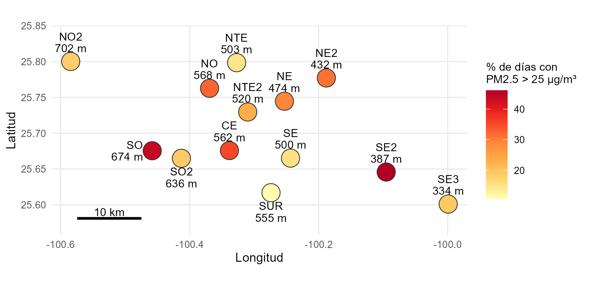
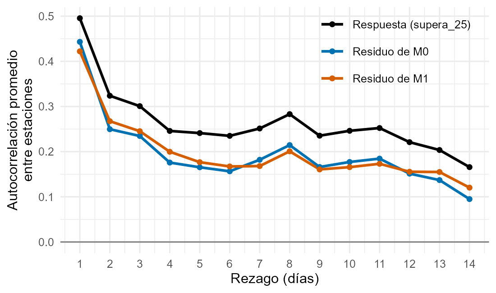
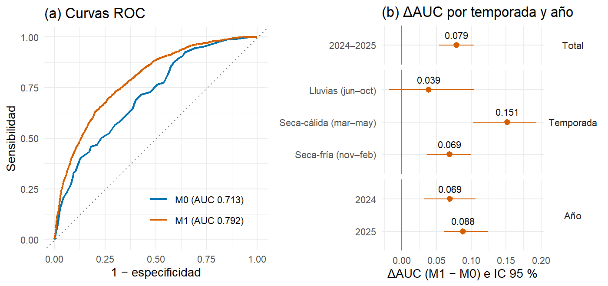
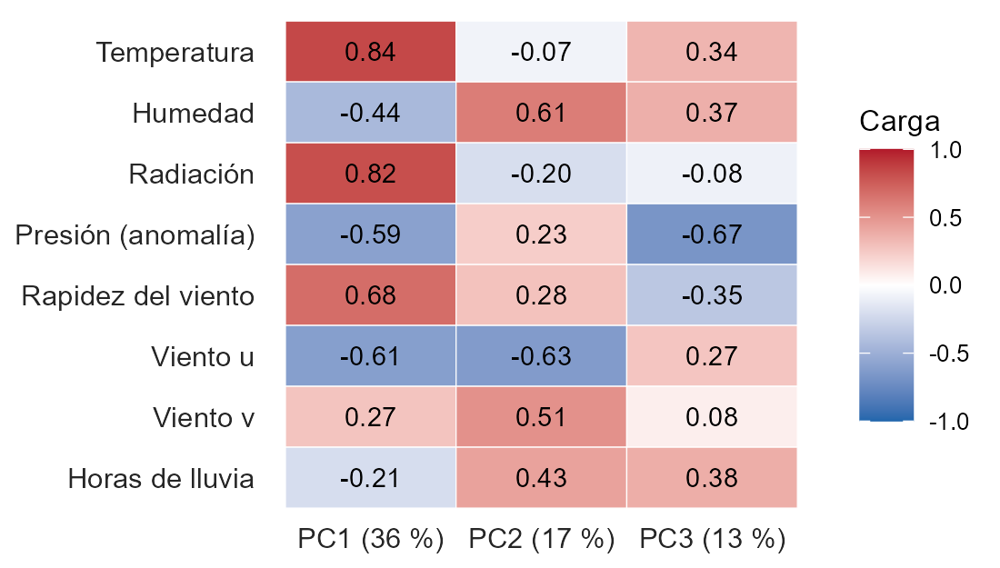
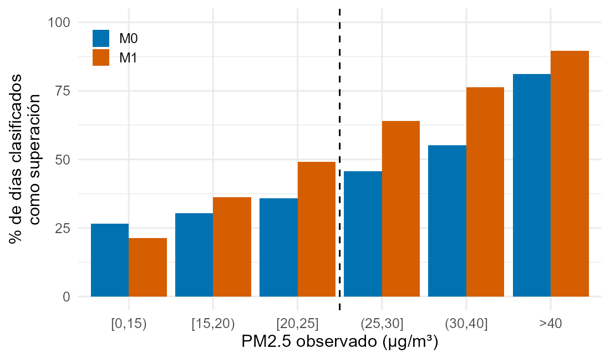
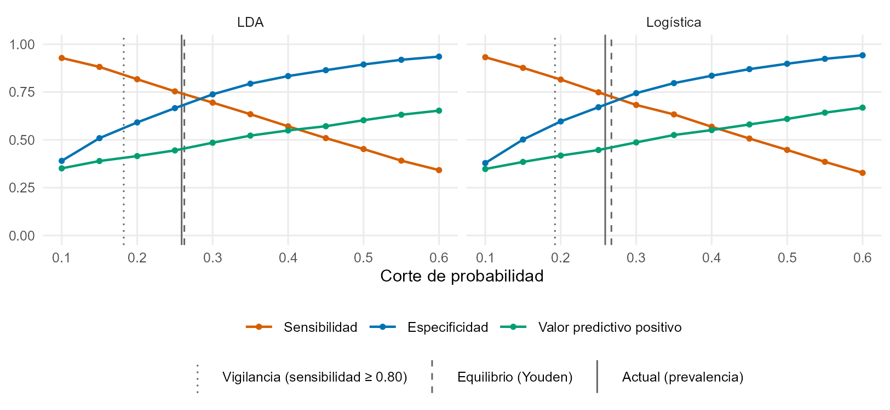
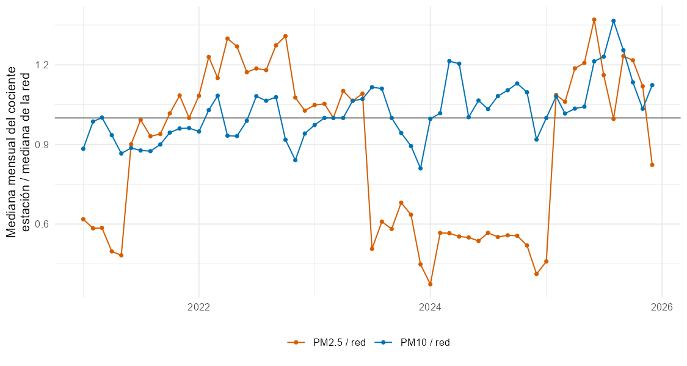
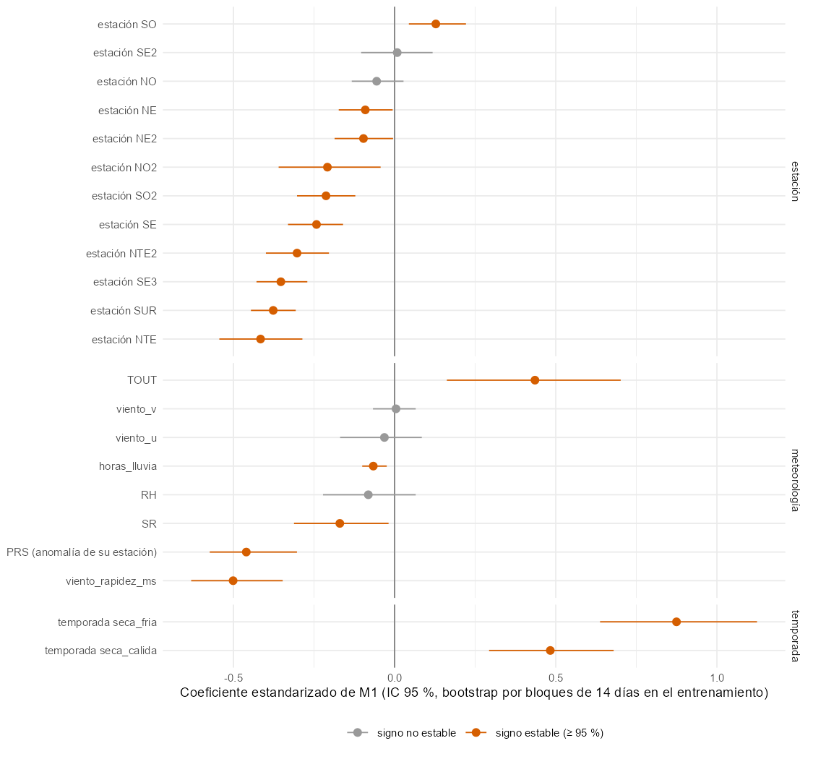

```{r}
#| label: setup
suppressPackageStartupMessages({
  library(data.table)
  library(knitr)
})
E4 <- "output/etapa4/"
miles <- function(x) formatC(x, format = "d", big.mark = " ")
f3 <- function(x) ifelse(is.na(x), "—", sprintf("%.3f", x))
f2 <- function(x) ifelse(is.na(x), "—", sprintf("%.2f", x))
f1 <- function(x) ifelse(is.na(x), "—", sprintf("%.1f", x))
ic <- function(a, b) sprintf("[%.3f, %.3f]", a, b)
# Tabla pipe con anchos relativos de columna: pandoc reparte el ancho de la pagina segun el numero
# de guiones de la linea separadora (si suman mas que --columns, que vale 72).
tabla <- function(df, anchos, align = rep("l", ncol(df))) {
  k <- kable(df, format = "pipe", align = align)
  n <- pmax(3, round(100 * anchos / sum(anchos)))
  sep <- vapply(seq_along(n), function(i) switch(align[i],
    l = paste0(":", strrep("-", n[i] - 1)), r = paste0(strrep("-", n[i] - 1), ":"),
    c = paste0(":", strrep("-", n[i] - 2), ":")), "")
  k[2] <- paste0("|", paste(sep, collapse = "|"), "|")
  k
}
```

::: {custom-style="Subtitle"}
Equipo 1 · Grupo 201 · Análisis multivariado (MA2003B) · Tecnológico de Monterrey

Socio formador: Sistema Integral de Monitoreo Ambiental (SIMA) y Agencia de Calidad del Aire de Nuevo León

Leonardo Orozco · Matrícula: ________

Pablo Alonso Robles Nava · Matrícula: ________

Daniel Ayala · Matrícula: ________

Ignacio Kume · Matrícula: ________

Profesores: Blanca Rosa Ruiz Hernández y Jesús [COMPLETAR apellidos]

Octubre de 2026
:::



# Resumen

**Problema y objetivo.** El Sistema Integral de Monitoreo Ambiental (SIMA) de Nuevo León registra con frecuencia días con PM2.5 elevado en la Zona Metropolitana de Monterrey (ZMM). Nos preguntamos cuánto mejora la meteorología observada del mismo día la identificación de los días-estación con PM2.5 promedio de 24 h mayor de 25 µg/m³ (límite de la NOM-025-SSA1-2021, usado como referencia fija), frente a un modelo que solo conoce la estación y la temporada.

**Datos y preparación.** Usamos los datos horarios de 13 estaciones entre 2021 y 2025. La limpieza por reglas físicas y de consistencia con la red invalidó el 0.7 % de los valores. **La variable respuesta no se imputa:** el PM2.5 diario se calcula solo con al menos 18 horas observadas. La meteorología horaria se imputó con métodos de imputeTS elegidos por enmascaramiento en 2021–2023; los días con hasta cuatro variables faltantes se completaron con la mediana de la red ajustada por estación, que superó a MICE en la validación. La base final tiene 17 828 días-estación; los días sin PM2.5 suficiente se concentran en dos estaciones y en 2024–2025.

**Técnicas.** Componentes principales (técnica de interdependencia) para describir la estructura de la meteorología, y dos técnicas de dependencia en paralelo para comparar M0 (estación y temporada) con M1 (M0 más ocho variables meteorológicas): el análisis discriminante lineal (LDA), fijado en el protocolo, y la regresión logística, nuestra referencia para interpretar las variables. Entrenamos con 2021–2023 y evaluamos 2024–2025, años que ya se habían usado en etapas previas (Sección 5.4). La incertidumbre se estimó con un bootstrap pareado por bloques de 14 días, también estratificado por temporada: es una validación temporal útil, no una confirmación independiente.

**Resultados.** La meteorología del día mejora el AUC entre 0.071 (regresión logística) y 0.079 (LDA) sobre estación y temporada, en la clasificación retrospectiva de 2024–2025 (LDA: de 0.713 a 0.792, IC 95 % [0.054, 0.104]). M1 detecta el 74 % de los días con superación (M0: 56 %) y el 72 % de los episodios, con una especificidad algo menor (0.68 frente a 0.70). La mejora es mayor de marzo a mayo (0.151), no se distingue de cero en lluvias, se mantiene entre 0.071 y 0.082 en las variantes analizadas y sube a 0.090 si la logística admite relaciones no lineales. Con signo estable en los dos clasificadores, la superación se asocia con viento débil, presión más baja de lo normal para el sitio y, al ajustar por estación y temporada, mayor temperatura. La persistencia (PM2.5 del día anterior) clasifica mejor que la meteorología del día (AUC 0.872 frente a 0.792), y la meteorología le agrega 0.016.

**Qué sí y qué no se puede concluir.** En el periodo evaluado, la meteorología observada mejora la clasificación retrospectiva frente a estación y temporada; no se respalda un pronóstico, no se identifican causas y las probabilidades no están calibradas. El LDA no cumple normalidad ni igualdad de covarianzas y los errores siguen autocorrelacionados: las medidas tomadas acotan la incertidumbre y evalúan el desempeño, pero no convierten el análisis en un modelo temporal ni en una alerta operativa.

**Recomendaciones para SIMA.** Evaluar el modelo con meteorología pronosticada y con la persistencia como base, junto con su área de pronósticos; elegir el corte según el uso (0.18 para vigilancia, con sensibilidad de 0.84 en la prueba, o 0.26 para equilibrar errores); incorporar dos reglas de control de calidad (radiación de madrugada y viento contra la red), y revisar el PM2.5 de García (NO2) entre 2023 y 2025 y la radiación de NO2 y NTE.



# 1. Introducción y justificación

El SIMA es la red de monitoreo de la calidad del aire del Gobierno de Nuevo León. Opera desde 1992 y sus 15 estaciones automáticas en la ZMM miden cada hora contaminantes criterio y variables meteorológicas. Con esos datos calcula el Índice Aire y Salud, elabora pronósticos y activa el programa de respuesta a contingencias (Sistema Integral de Monitoreo Ambiental [SIMA], 2026). El Plan Integral de Gestión Estratégica de la Calidad del Aire 2023–2033 (PIGECA) le asigna generar información confiable para evaluar la calidad del aire y sus impactos, y contempla medidas de fortalecimiento de la red y de pronóstico (Secretaría de Medio Ambiente del Estado de Nuevo León [SMA] y Clean Air Institute [CAI], 2024).

El PM2.5 es el contaminante en el que nos enfocamos. Un metaanálisis de 196 artículos asoció la exposición de corto plazo a partículas con mayor mortalidad total, cardiovascular y respiratoria (Orellano et al., 2020), y la Organización Mundial de la Salud fijó en 2021 una guía de 15 µg/m³ para el promedio de 24 h (World Health Organization [WHO], 2021). Usamos como umbral 25 µg/m³, el límite de 24 h de la NOM-025-SSA1-2021 en su quinto año de aplicación (Secretaría de Salud, 2021). Es una **referencia fija para comparar todo el periodo, no una evaluación del cumplimiento normativo**, porque los límites aplicables cambiaron entre 2021 y 2025. El resultado describe concentraciones, no riesgo individual: por debajo de 25 µg/m³ el riesgo no es nulo.

**Antecedentes en la ZMM.** Aguirre-López et al. (2022) describieron en siete estaciones una tendencia decreciente del PM10 con ciclo anual (2010–2018) y propusieron incorporar la meteorología. Hernández-Romero et al. (2026) documentaron la persistencia de excedencias de PM10, PM2.5 y O3, con máximos de partículas en la temporada seca-fría. Martínez-Cinco et al. (2016) atribuyeron el PM2.5 otoñal sobre todo a emisiones vehiculares que se acumulan con viento débil. Ramírez-Velarde et al. (2024) combinaron componentes principales y clasificadores con meteorología del SIMA para anticipar contingencias. Fuera de México, Vélez-Pereira et al. (2025) clasificaron con regresión logística las superaciones diarias de PM2.5 y PM10 en varias ciudades de Chile, como base simple para alertas tempranas.

**Justificación para SIMA.** Saber en qué temporadas y con qué condiciones la meteorología del día añade información sobre los días de PM2.5 alto es un paso previo a una alerta con pronóstico, que el área de pronósticos de SIMA dijo que le interesa (SIMA, comunicación personal, 15 de octubre de 2026). Primero hay que medir cuánto ayuda la meteorología observada; si no ayuda con datos medidos, tampoco ayudará con datos pronosticados.

**Alcance dentro del reto.** El proyecto cubre cuatro puntos del reto: la clasificación de días con y sin superación del umbral fijo de 25 µg/m³, los factores meteorológicos asociados, la distribución por estación y el contexto de fuentes de las estaciones más afectadas. No evalúa el cumplimiento normativo ni el efecto de la política ambiental antes y después de 2022 o de la pandemia (Schiavo et al., 2023); estos últimos quedan como preguntas nuevas (Sección 7).

# 2. Problemática y objetivo

**Pregunta.** ¿En qué medida la meteorología del día mejora la clasificación retrospectiva de los días-estación con PM2.5 promedio de 24 h superior a 25 µg/m³, respecto de un modelo que solo considera la estación de monitoreo y la temporada, en 13 estaciones de la ZMM durante 2021–2025?

**Objetivo general.** Cuantificar, con validación temporal, la mejora en el área bajo la curva ROC (ΔAUC) que aporta la meteorología del día (M1) sobre un modelo con estación y temporada (M0), con análisis discriminante lineal (LDA), la técnica fijada en el protocolo, y con regresión logística en paralelo.

**Objetivos específicos.** (1) Construir una base día-estación con limpieza documentada e imputación validada, sin imputar la respuesta. (2) Describir la estructura de correlación de la meteorología con componentes principales (PCA). (3) Estimar M0 y M1 y su diferencia, con intervalos que respeten la dependencia temporal y espacial. (4) Identificar en qué temporadas y con qué variables se concentra la mejora, y qué permiten concluir los dos clasificadores. (5) Traducir los resultados en recomendaciones para SIMA.

**Evolución del alcance.** En la etapa 1 propusimos identificar regímenes multicontaminante con conglomerados. La retroalimentación pidió acotar el problema y lo reenfocamos en el PM2.5 y en la comparación M0–M1 (etapa 2). En la etapa 4 atendimos la retroalimentación sobre la imputación y sobre el uso del LDA. **Alcance:** clasificación retrospectiva con meteorología observada del mismo día, no pronóstico.

# 3. Área de estudio: estaciones y factores geográficos

La ZMM ocupa un valle rodeado por la Sierra Madre Oriental al sur y al oeste y por sierras como el Cerro de la Silla. Las 13 estaciones de la muestra van de 334 m (SE3, Cadereyta) a 702 m de altitud (NO2, García); el oeste (Santa Catarina, San Pedro y García) es más alto y encajonado (@fig-mapa, @tbl-estaciones). En nuestros datos domina el flujo del este: la componente zonal del viento es negativa (*u* < 0) en el 80 % a 98 % de los días en 11 de las 13 estaciones, con dirección resultante entre 68° y 140° (del este al sureste). Las excepciones son NE2 (62 %) y SO2 (68 %). Según SIMA, el viento predominante sale del área metropolitana por Santa Catarina y García (comunicación personal, 15 de octubre de 2026).

{#fig-mapa width="6.0in"}

La @fig-mapa muestra que la superación no sigue la altitud: SO (674 m) y SE2 (387 m) tienen los porcentajes más altos y están en extremos opuestos del valle, mientras que SE3 (334 m) y NO2 (702 m) están por debajo de la mitad de la red.

```{r}
#| label: tbl-estaciones
#| tbl-cap: "Estaciones de la muestra: altitud, días-estación en el análisis final y porcentaje con PM2.5 > 25 µg/m³ (base v2, 2021–2025). Municipio según los metadatos de SIMA; el de NTE2, SE3 y SUR (marcado con *), que no viene en ellos, se completó por la ubicación de la estación."
m <- fread(paste0(E4, "area_estudio/mapa_estaciones_altitud.csv"))
m <- m[order(-pct_superacion_v2)]
completar <- c(NTE2 = "San Nicolás de los Garza*", SE3 = "Cadereyta Jiménez*", SUR = "Monterrey*")
m[municipio == "" | is.na(municipio), municipio := completar[estacion]]
tabla(m[, .(Código = estacion, Nombre = nombre, Municipio = municipio, `Altitud (m)` = altitud_msnm,
            `Días-estación` = miles(dias_v2), `% superación` = f1(pct_superacion_v2))], c(9, 18, 28, 13, 15, 15), c("l", "l", "l", "r", "r", "r"))
```

**Contexto por estación.** SIMA describió las fuentes de las dos estaciones con más superaciones (comunicación personal, 15 de octubre de 2026), y las contrastamos con nuestros datos:

- **SE2 (Juárez).** Es el primer receptor de la pluma de la refinería: por la altura de los quemadores, la dispersión pasa por encima de Cadereyta (SE3) y llega a Juárez. Además, hay crecimiento urbano, vialidades sucias con resuspensión, quemas nocturnas, transporte pesado y obras viales. En nuestros datos, SE2 tiene el viento más débil de la red (1.55 m/s de media) y el PM2.5 más ligado al PM10 (Spearman 0.82). Sin embargo, su cociente PM2.5/PM10 (0.40) está entre los más altos, más compatible con partículas finas de combustión que con polvo grueso. En enero el PM2.5 medio de SE2 subió de 33.1 a 43.1 µg/m³ entre 2023 y 2024, mientras que en SE3 no cambió (22.4 µg/m³). El cambio va en la misma dirección que el alza que el gobierno estatal atribuyó a la refinería, aunque sus cifras no son las nuestras (Gobierno del Estado de Nuevo León, 2024).
- **SO (Santa Catarina).** Es una zona industrial de entrada, con suelo semidesértico, carga vehicular y receptora de la salida del viento. En nuestros datos los días con superación tienen viento más débil (diferencia de medias estandarizada de la rapidez −0.76, la mayor de la red) y un flujo del este menos intenso (*u* de −1.16 frente a −2.01 m/s). Con promedios diarios no se puede separar la acumulación local del transporte desde la ciudad.
- **SUR (Pueblo Serena).** Su reubicación se ve en los datos: pasó de 3.0 % de días con superación en 2021 a 10–12 % desde 2022, y su presión frente a la red cambió +5.7 mm Hg en la fecha de reubicación.

Son explicaciones de contexto, consistentes con los datos, que no se pueden atribuir sin inventarios de emisiones ni análisis horario de transporte.

**Cambios en la red (@tbl-cambios, Anexo B).** El PIGECA registra reubicaciones de NO (junio de 2021), SE, SO, NTE y SUR (septiembre de 2021) y NE (febrero de 2022) (SMA y CAI, 2024, p. 91): el entrenamiento excluye los días previos (D23), y con las reubicaciones que confirmó SIMA la mejora es de 0.081. Los sensores de viento se renovaron en 2021 (por eso se excluye 2020) y cinco equipos de PM2.5 cambiaron en 2025 (mejora de 0.069 en 2024 y 0.088 en 2025). El PM2.5 de NO2 baja a la mitad del nivel de la red con su PM10 normal (sin NO2: 0.082), y la radiación de NO2 y NTE es muy baja (con la radiación imputada truncada en 0: 0.079).

# 4. Preparación de la base de datos

## 4.1 Datos y diagnóstico

SIMA entregó seis libros de Excel (2020–2025) con 87 hojas estación-año y datos horarios de 15 estaciones y 15 variables. Sobre los valores horarios esperados faltaba el 12.3 %, y en PM2.5 el 26.0 %. Los faltantes son sobre todo apagones largos: en las seis variables que se imputan o se modelan, entre el 51 % y el 82 % de las horas faltantes están en huecos de más de un día (@tbl-huecos, Anexo B). Esto descarta reconstruir esos huecos con métodos locales y motiva imputar a nivel diario con información de la red (Sección 4.3).

## 4.2 Limpieza por reglas

Cada hora de cada variable conserva una bandera que indica si es válida o por qué se anuló; no se elimina ninguna fila (@tbl-limpieza, Anexo B). Las reglas de consistencia espacial (D14) comparan cada lectura con la mediana de la red a la misma hora (Fiebrich et al., 2010). La regla D15 anula la radiación de todo un día si su media de madrugada supera 0.02 kW/m², y el viento que excede por mucho al de la red (Estévez et al., 2011); se agregó porque la exploración encontró radiación nocturna en NO2, SE3 y CE y vientos imposibles en SO2 y NE2. En total se invalidó el 0.7 % de los valores. Los extremos que pasan todas las reglas se conservan, porque pueden ser concentraciones reales. Excluimos 2020 del modelado, porque el viento cambió de nivel con la renovación de sensores de 2021 y por el confinamiento, y las estaciones NE3 y NO3, que casi no miden PM2.5. El detalle de cada regla está en el Anexo B.

## 4.3 Imputación

**Principio: la respuesta no se imputa (D18).** El PM2.5 diario se calcula solo con al menos 18 horas observadas, el criterio de suficiencia de la NOM-025-SSA1-2021. Imputar el PM2.5 crearía etiquetas de superación que nadie midió, y atiende la advertencia de SIMA sobre los huecos largos en Juárez y Santa Catarina. El costo es perder 526 días-estación con respuesta válida frente a la etapa 3. Las ventanas grandes de la meteorología se recuperan a nivel diario con la información de la red (D20); las del PM2.5 no se rellenan.

```{r}
#| label: tbl-imputacion
#| tbl-cap: "Imputación horaria de la meteorología elegida por enmascaramiento (2021–2023): método, hueco máximo imputado (maxgap), error medio de la interpolación lineal frente al ganador, porcentaje de imputaciones revertidas por la revalidación y horas imputadas en 2021–2025 (13 estaciones) frente a la etapa 3."
e <- fread(paste0(E4, "imputacion/eleccion_metodo_horario.csv"))
hi <- fread(paste0(E4, "imputacion/imputacion_horaria_v12_v2.csv"))
nm <- c(linear = "Interpolación lineal", stine = "Interpolación de Stineman", kalman = "Kalman (StructTS)", seadec = "Descomposición estacional")
var <- c(TOUT = "Temperatura", RH = "Humedad relativa", SR = "Radiación solar", PRS = "Presión", viento_u = "Viento u", viento_v = "Viento v")
x <- merge(e, hi[, .(variable, imputadas_v12, imputadas_v2)], by = "variable")[match(names(var), variable)]
tabla(x[, .(Variable = var[variable], Método = nm[metodo_elegido], `maxgap (h)` = maxgap_h,
            `Error de la lineal frente al ganador` = paste0("+", f1(lineal_sobre_ganador_pct), " %"),
            `% revertido` = f2(pct_reversion_elegido), `Horas imputadas (etapa 3 → etapa 4)` = paste(miles(imputadas_v12), "→", miles(imputadas_v2)))],
      c(18, 24, 11, 16, 12, 19), c("l", "l", "r", "r", "r", "r"))
```

**Imputación horaria de la meteorología (D19).** Usamos los métodos de la fuente principal del curso, el paquete imputeTS (Moritz & Bartz-Beielstein, 2017): interpolación lineal, spline y de Stineman, media móvil exponencial, filtro de Kalman, descomposición estacional y LOCF como piso. Los elegimos por enmascaramiento solo en 2021–2023: en tramos completos borramos bloques de 1 a 24 h que sí conocemos, los imputamos con cada método y medimos el error del **promedio diario**, que es lo que entra al modelo. La regla, fijada antes de ver los resultados y corregida antes de cerrar las decisiones (registro de cambios de la fase A), descalifica los métodos cuyas imputaciones revierte la revalidación en más de 5 %. Exige además un error diario de a lo más el 10 % de la desviación de la anomalía de cada variable. La @tbl-imputacion resume el resultado, y la @fig-imputacion (Anexo B) muestra que en huecos de 6 a 24 h la descomposición estacional comete cerca de la mitad del error de la interpolación lineal y que, en el PM2.5, la interpolación aplana los picos, otra razón para no imputar la respuesta. No usamos imputación por vecinos cercanos (KNN).

**Imputación diaria de la meteorología (D20).** Con la imputación horaria quedan días con una a cuatro de las ocho variables faltantes, sobre todo radiación y humedad. Para recuperarlos comparamos tres métodos en una validación por enmascaramiento con el patrón real de faltantes de 2021–2023. El primero es la mediana de las otras estaciones ese día, ajustada por la diferencia media de la estación, un método de efecto por sitio en la línea de Plaia y Bondì (2006). Los otros dos son MICE con *predictive mean matching* (van Buuren & Groothuis-Oudshoorn, 2011) y la media de estación × temporada. Ganó la mediana ajustada: RMSE relativo medio de 0.450, frente a 0.593 de MICE y 0.736 de la media; también ganó en temperatura y humedad, las que más faltan en 2024–2025. Si se promedian las cinco imputaciones de MICE utilizadas en el experimento de selección, el error baja a 0.436, ligeramente por debajo; pero promediar elimina la variabilidad que justifica la imputación múltiple, y la regla registrada compara cada base imputada. La sensibilidad posterior del clasificador utiliza 20 bases imputadas y arroja ΔAUC = 0.078 (@tbl-robustez). La mediana ajustada se usa con una sola imputación. Ninguna imputación usa el PM2.5 ni la superación como predictor. Moons et al. (2006) muestran que incluir la respuesta al imputar predictores puede reducir el sesgo de las asociaciones. Aquí se excluyó de la imputación para conservar una evaluación predictiva en la que la respuesta de prueba no interviene en los predictores. La idea de aprovechar la red coincide con antecedentes que encontraron mejores imputaciones con información de estaciones vecinas (Quinteros et al., 2019; Belachsen & Broday, 2022) y suficiencia de métodos simples para promedios diarios (Hadeed et al., 2020).

**Imputación de referencia del curso.** El curso recomienda como referencia de imputación con datos del SIMA el trabajo MIMA-v1 (Gómez et al., 2025; Gómez Santos et al., 2027), un modelo generativo (SAITS + CSDI) que reconstruye series horarias completas, incluidos los huecos largos. No se usó en el análisis por cuatro razones: (a) solicitamos acceso a su dataset imputado y no lo obtuvimos a tiempo; (b) su cobertura es de 9 estaciones, de enero de 2021 a junio de 2025, sin Juárez (SE2), Cadereyta (SE3), SUR ni NE2; (c) imputa también el PM2.5, lo que crearía etiquetas de superación sin medición, y nuestro diseño no imputa la respuesta (D18); y (d) entrenarlo nosotros requiere su base limpia, con acceso autorizado, y su licencia exige autorización escrita para modificaciones o distribución derivada. Hay coincidencias con su trabajo: en su comparación de métodos clásicos, la interpolación lineal tuvo el menor error (MAE de 4.01) y la descartaron porque suaviza los picos. Nuestro enmascaramiento confirma ese suavizado en el PM2.5; por eso no imputamos la respuesta y elegimos el método horario de la meteorología con validación. De las fuentes del curso tomamos los métodos de imputeTS (Moritz & Bartz-Beielstein, 2017) y la validación por enmascaramiento.

## 4.4 Transformaciones

- **Agregado diario:** un valor diario existe con al menos 18 horas válidas de esa variable.
- **Viento:** componentes *u* (este-oeste) y *v* (norte-sur) y rapidez, porque la dirección es circular.
- **Lluvia:** horas con lluvia en el día, porque la unidad de la cantidad no está confirmada.
- **Presión:** anomalía respecto de la media de su sitio en el entrenamiento (D17); separa la altitud (medias de 700.8 a 731.5 mm Hg) del efecto meteorológico.
- **Escalado:** todas las variables se estandarizan con medias y desviaciones del entrenamiento.
- **Sin logaritmos (D16):** en la validación progresiva, transformar la lluvia y el viento solo subió el AUC 0.003 y 0.007, y el logaritmo sobrecorregía la asimetría del viento (de +0.37 a −0.98).

## 4.5 Muestra final, exclusiones y posible sesgo

La @tbl-exclusiones clasifica los 23 738 días-estación posibles (13 estaciones × 1 826 días) según su causa de exclusión: la imputación diaria recupera los días con una a cuatro meteorológicas faltantes, no los que tienen cinco o más, y el entrenamiento excluye los días previos a cada reubicación (D23), porque corresponden a otro sitio. El análisis final queda con **17 828 días-estación**: 10 965 de entrenamiento (2021–2023; 25.9 % de superación) y 6 863 de prueba (2024–2025; 26.2 %). Frente a la etapa 3 hay 2 438 días más, sobre todo en García (NO2: de 511 a 1 532), donde faltaba la radiación, y en Escobedo (NTE: de 597 a 1 373), donde faltaba la humedad (Anexo C). La tabla compara además la respuesta donde sí puede calcularse.

```{r}
#| label: tbl-exclusiones
#| tbl-cap: "Causas de exclusión de los 23 738 días-estación posibles (2021–2025) y respuesta de cada grupo donde existe. Las causas (a) a (d) suman el total; (e) es parte de (b) y (c). Detalle por estación, temporada y año en el Anexo B."
RF <- "output/etapa4/retro_final/"
ca <- fread(paste0(RF, "f1_causas_total.csv")); rg <- fread(paste0(RF, "f2_respuesta_por_grupo.csv"))
x <- merge(ca, rg, by.x = "causa", by.y = "grupo", all.x = TRUE)[order(causa)]
x[, Grupo := c("(a) Sin PM2.5 suficiente (< 18 h observadas)", "(b) Respuesta y meteorología completa", "(c) Respuesta y 1–4 meteorológicas imputadas",
               "(d) Respuesta y 5–8 meteorológicas faltantes", "(e) De (b) o (c), previos a una reubicación")]
tabla(x[, .(Grupo, `Días-estación` = miles(N), `%` = f1(pct), `¿En el análisis?` = c("No", "Sí", "Sí", "No", "No"),
            `% superación` = f1(pct_superacion), `Mediana de PM2.5` = f1(mediana_pm25), `% con PM2.5 > 40` = f1(pct_mayor_40))],
      c(36, 12, 7, 12, 11, 11, 11), c("l", "r", "r", "l", "r", "r", "r"))
```

Donde hay respuesta, los excluidos se parecen a los incluidos: 33.3 % de superación en (d), con solo 189 días, y 29.5 % en (e), frente a 27.0 % en (b). Los días que recupera la imputación (c) tienen menos superación en promedio (23.5 %), pero la diferencia cambia de signo según la estación: en NO2, donde faltaba la radiación, es de 22.7 % en (c) y 9.8 % en (b). Con casos completos, la etapa 3 daba a NO2 10.0 % de superación y la base final 18.4 %: esa exclusión sesgaba la muestra. Los días sin PM2.5 suficiente (a) se concentran en NO (57 % de sus días, con un hueco de 532 días desde marzo de 2024), NE2 (33 %) y SUR (26 %), y en 2024–2025 (24 % y 30 %, frente a 10–15 % antes); la mitad están en huecos de más de una semana y se reparten casi igual entre temporadas. Su PM10, disponible en el 86 % de ellos, es menor que el de los días con respuesta en 31 de 39 combinaciones de estación y temporada, así que no parecen concentrarse en días de contaminación alta. Aun así, no podemos descartar un sesgo por datos faltantes, sobre todo en la prueba y en NO y NE2.

# 5. Modelación y validación

## 5.1 Ruta de análisis

La @tbl-ruta vincula cada técnica con su pregunta, sus variables, su respaldo metodológico y artículos que la aplicaron en contextos ambientales o con series de tiempo. Para nuestro objetivo, el PCA muestra qué condiciones meteorológicas varían juntas. El LDA, fijado en el protocolo, mide cuánto separa la meteorología los días con y sin superación por encima de estación y temporada. La logística responde lo mismo sin suponer normalidad y expresa cada efecto en momios. El bootstrap por bloques da un intervalo que respeta la persistencia entre días y estaciones. La validación progresiva comprueba que la mejora se repite en años que el modelo no vio.

```{r}
#| label: tbl-ruta
#| tbl-cap: "Ruta de análisis: técnica y tipo, pregunta, variables, justificación, respaldo metodológico y aplicación previa en contextos ambientales o de series de tiempo."
ruta <- data.table(
  Técnica = c("Componentes principales (PCA; interdependencia)", "Análisis discriminante lineal (LDA; dependencia, fijada en el protocolo)",
              "Regresión logística (dependencia, en paralelo)", "Bootstrap pareado por bloques", "Validación temporal progresiva"),
  Pregunta = c("¿Cómo se estructura la correlación de la meteorología?", "¿Cuánto mejora M1 a M0?",
               "¿Qué variables influyen? ¿Depende la conclusión de los supuestos del LDA?", "¿Qué tan incierta es la ΔAUC?", "¿Se sostiene la mejora en años posteriores?"),
  Variables = c("8 meteorológicas, como anomalías por estación", "Estación y temporada; en M1, + 8 meteorológicas", "Las mismas que el LDA",
                "Predicciones de la prueba en bloques de 14 días", "Entrenar en años anteriores y evaluar el siguiente"),
  `Por qué es adecuada` = c("Resume variables correlacionadas en pocos ejes; describe, no predice",
                            "Función lineal interpretable; con la misma partición, M1 − M0 se atribuye a la meteorología",
                            "No supone normalidad ni covarianzas iguales; referencia para interpretar las variables",
                            "La contaminación alta persiste días y afecta a varias estaciones",
                            "Con datos ordenados en el tiempo, la validación aleatoria sobreestima el desempeño"),
  Respaldo = c("Jolliffe y Cadima (2016)", "Johnson y Wichern (2007); Krzanowski (1975)", "Efron (1975); James et al. (2021)",
               "Carlstein (1986); Künsch (1989)", "Roberts et al. (2017)"),
  `Aplicación previa en contexto ambiental o de series de tiempo` = c(
    "Ramírez-Velarde et al. (2024): meteorología de la ZMM y contingencias; Mohd Shafi'i y Juahir (2024): 8 estaciones de Malasia",
    "Mohd Shafi'i y Juahir (2024): 90.5 % de los casos bien asignados a grupos de estaciones por contaminación",
    "Vélez-Pereira et al. (2025): superaciones diarias de PM2.5 y PM10 en Chile; Saminathan y Malathy (2023): PM2.5 con meteorología en Pekín",
    "Wilks (2019): datos atmosféricos autocorrelacionados", "Roberts et al. (2017): datos ecológicos con estructura temporal"))
tabla(ruta, c(16, 15, 15, 18, 13, 23))
```

## 5.2 Componentes principales

El PCA se ajustó solo con el entrenamiento, sobre las anomalías de cada variable respecto de la media de su estación, para que los ejes describan la variación meteorológica y no las diferencias entre sitios. La adecuación es modesta: KMO = 0.64, valor que Kaiser y Rice (1974) clasifican como mediocre; por ello el PCA se utiliza con fines exploratorios. La prueba de Bartlett (1950) rechaza la esfericidad (χ² = 26 503, gl = 28, p < 0.001). Tres valores propios superan 1 (criterio de Kaiser, 1960) y explican el 66.5 % de la varianza. Tampoco es un predictor: maximizar la varianza no maximiza la separación entre clases, y su primer eje mezcla variables que se asocian con la superación en sentidos contrarios (Sección 6.3). En la etapa 3, usar los tres componentes en lugar de las ocho variables dio una mejora menor (Anexo A). **El PCA resume la correlación entre variables, pero no elimina la autocorrelación temporal de los días.**

## 5.3 LDA y el tratamiento de estación y temporada

**Codificación.** Estación (13 niveles) y temporada (3) entran como variables indicadoras, k − 1 por factor, con categoría de referencia CE (Obispado) y temporada cálida-húmeda: 12 indicadoras de estación y 2 de temporada, estandarizadas con el entrenamiento como el resto de los predictores. **M0** usa solo esas 14 indicadoras. Su función discriminante asigna a cada día un puntaje que es la suma de un efecto de estación y uno de temporada, así que M0 da una misma probabilidad a todos los días de cada una de las 39 combinaciones estación × temporada: es la referencia de lo que ya se sabe sin la meteorología diaria. **M1** agrega a las mismas indicadoras las ocho variables meteorológicas continuas (22 predictores).

**Por qué es apropiado para los dos modelos.**

1. Mismo método y misma partición: la diferencia M1 − M0 se atribuye a la meteorología y no al clasificador.
2. El criterio de Fisher, que busca la combinación lineal que separa las medias de las clases en relación con la dispersión dentro de ellas, no requiere normalidad. La regla y sus probabilidades solo son óptimas si los predictores son normales con una covarianza común en las dos clases (Johnson & Wichern, 2007).
3. Con indicadoras, la normalidad multivariada no se cumple literalmente. Por eso el LDA se usa como clasificador lineal y no como modelo generativo bien especificado. Para predictores mixtos, Krzanowski (1975) propuso el modelo de localización, que generaliza el discriminante a variables binarias y continuas; la regla lineal que usamos es una aproximación que supone que el efecto de la meteorología sobre la separación es el mismo en todas las estaciones y temporadas.
4. El logit de la probabilidad posterior del LDA es lineal en los predictores, igual que en la regresión logística. Con normalidad condicional y covarianza común, el LDA puede ser más eficiente asintóticamente que la logística (Efron, 1975). La logística no exige una distribución normal de los predictores, aunque sí especifica una forma para la probabilidad condicional; su comparación con el LDA aporta aquí evidencia empírica de estabilidad.

**Dos clasificadores en paralelo.** Conservamos el LDA, fijado en el protocolo antes de evaluar, y reportamos junto a él la regresión logística con los mismos predictores, que da resultados similares y es la referencia para interpretar las variables (Sección 5.5). Tampoco resuelve todo: requiere especificar bien la relación de cada predictor con el logit (razón 4), y la autocorrelación invalida su inferencia convencional.

**Prior y corte.** La probabilidad previa es la prevalencia del entrenamiento (0.259), y un día se clasifica como superación si su probabilidad posterior es al menos esa prevalencia. El corte se fijó antes de ver la prueba; la Sección 6.6 evalúa cortes elegidos con el entrenamiento para usos concretos.

## 5.4 Supuestos: qué se revisó, qué implica y qué no se puede concluir

```{r}
#| label: tbl-supuestos
#| tbl-cap: "Supuestos del LDA y un diagnóstico adicional de los residuos, revisados en el entrenamiento (n = 10 965) y en los errores de la prueba (n = 6 863), con su implicación y su tratamiento (base v2)."
sup <- data.table(
  Supuesto = c("Normalidad multivariada por clase", "Igualdad de covarianzas", "Independencia", "Multicolinealidad",
               "Diagnóstico adicional: variación de los residuos y calibración"),
  Diagnóstico = c("Mardia (1970), 8 meteorológicas; las indicadoras son discretas", "M de Box (1949) y razón de desviaciones por clase",
                  "ACF del residuo dentro de cada estación; correlación entre estaciones el mismo día", "VIF y número de condición",
                  "Varianza de Y − p̂ por temporada y estación (Brown-Forsythe, solo descriptivo por la dependencia de los registros); error por decil"),
  Resultado = c("No se cumple: asimetría χ² = 99 015 y 198 072 (gl = 120, p < 0.001); lluvia con asimetría de 7.6 y 19.9",
                "No se cumple: χ² = 3 213 (gl = 36, p < 0.001); diferencia sobre todo en la lluvia (razón 0.40) y en v (0.78); en las demás, 0.85–1.05",
                "No se cumple: ACF a 1 día de 0.42 en el residuo de M1 (0.50 en la respuesta); 0.36 entre estaciones",
                "Baja: VIF máximo 2.28 (temperatura); número de condición 2.97",
                "La varianza de Y − p̂ cambia entre temporadas (0.086–0.205; F = 503); en el decil más alto el error es 1.34 veces el esperado; pendiente de recalibración de 0.82"),
  Implicación = c("No está garantizada la optimalidad de la regla ni la calibración de sus probabilidades",
                  "La igualdad de covarianzas no está respaldada; una frontera lineal puede perder eficiencia", "Los errores estándar usuales no valen",
                  "Los coeficientes se pueden leer en conjunto",
                  "Esperable en parte por la respuesta binaria; no constituye un supuesto incumplido del LDA"),
  `Cómo se tomó en cuenta` = c("LDA como clasificador; logística como contraste (0.071)", "QDA como alternativa: no mejora (0.788 frente a 0.792)",
                               "Bootstrap por bloques; estabilidad por bootstrap; sin valores p", "Presión como anomalía; interpretación conjunta",
                               "Las probabilidades necesitan evaluación y recalibración antes de comunicarse como riesgos; se usan como puntajes"))
tabla(sup, c(16, 20, 26, 17, 21))
```

La @tbl-supuestos muestra que el LDA no cumple sus supuestos distribucionales, y conviene precisar qué hace cada herramienta. El bootstrap por bloques estima la incertidumbre del **desempeño** respetando grupos de fechas, pero no vuelve independientes los datos con los que se ajusta el LDA: por eso no reportamos valores p de los coeficientes. El PCA controla la correlación entre variables, no la autocorrelación. La validación temporal mide cómo clasifica el modelo en años posteriores, aunque 2024–2025 ya se habían usado en una prueba de viabilidad preliminar (4 de octubre), en la evaluación de la etapa 3 y en la de la etapa 4. En las etapas 3 y 4 las decisiones se cerraron antes de evaluar la prueba con la base correspondiente; sin embargo, los cambios de la etapa 4 se decidieron después de conocer el resultado de la etapa 3. La mejora coincide con la de la validación progresiva dentro del entrenamiento (Sección 5.7), pero esa prueba ya no es completamente nueva y lo declaramos. Por todo esto, la evidencia que presentamos es empírica: validación temporal, comparación con la logística y estabilidad de los coeficientes. No interpretamos la función discriminante como un modelo generativo.

## 5.5 Regresión logística: variables y linealidad

**Variables relevantes.** Ajustamos M1 logístico con los 22 predictores estandarizados del LDA, con intervalos del mismo bootstrap por bloques del entrenamiento y sin valores p, que la dependencia entre días invalida. Las ocho meteorológicas tienen el signo del LDA (@fig-coef, panel b). Con lo demás constante, 1 DE más de rapidez del viento (0.85 m/s) multiplica las momios de superación por 0.49 (IC 95 % [0.39, 0.62]); de presión respecto de lo normal del sitio (3.5 mm Hg), por 0.58 [0.49, 0.70]; de temperatura (6.3 °C), por 1.78 [1.24, 2.71]; de horas de lluvia (1.1 h), por 0.81 [0.64, 0.93], y de radiación (0.08 kW/m²), por 0.82 [0.67, 1.00]. La humedad, *u* y *v* no tienen signo estable. Al permutar cada grupo de variables en la prueba, el AUC cae sobre todo con la temporada (0.138) y la estación (0.067) y, entre las meteorológicas, con la presión (0.051), la rapidez del viento (0.038) y la temperatura (0.032); las demás lo mueven menos de 0.01. La mejora de M1 descansa, pues, en la ventilación, la presión y la temperatura, con los dos clasificadores.

**Linealidad en la escala logit (@fig-linealidad, Anexo C).** En el entrenamiento, los logits empíricos por deciles, ajustados por las demás variables, y un modelo aditivo generalizado (GAM) logístico con un spline penalizado por variable (Wood, 2017) muestran curvatura: de 5.4 a 8.4 grados de libertad efectivos, salvo en la lluvia (1.6). El efecto de la temperatura crece más rápido arriba de 28 °C, el de la rapidez del viento se aplana arriba de 3 m/s y el de la humedad cae arriba de 70 %; la presión es casi lineal. La regla fijada antes de evaluar la prueba (splines si suben el AUC de validación en ≥ 0.005 en los dos pliegues) se cumplió (+0.006 en 2022 y +0.021 en 2023), así que los reportamos como tratamiento de la no linealidad: en la prueba, M1 con splines llega a un AUC de 0.811 y mejora a M0 logístico en 0.090 [0.060, 0.120], frente a 0.071 con la forma lineal. El modelo principal no cambia; su forma lineal, si acaso, subestima lo que aporta la meteorología. La indicadora «llovió» no agrega nada a las horas de lluvia.

## 5.6 Análisis de los errores

Con las predicciones de la prueba calculamos el residuo de cada día (superación observada menos probabilidad) y su autocorrelación dentro de cada estación (@fig-acf).

{#fig-acf width="4.0in"}

La @fig-acf muestra que agregar la meteorología reduce poco la dependencia. La autocorrelación a un día baja de 0.50 en la respuesta a 0.44 con M0 y a 0.42 con M1, y la correlación entre estaciones el mismo día baja de 0.48 a 0.36. **El modelo no absorbe toda la dependencia**, y esa es la razón del bootstrap por bloques y del límite a la interpretación. La varianza de los errores también difiere entre temporadas y estaciones, algo esperable en parte con una respuesta binaria, y la calibración es imperfecta: la pendiente de la recalibración es 0.82, cuando el ideal es 1, y en todas las temporadas queda entre 0.69 y 0.76 (Anexo C). Las probabilidades deben leerse como puntajes.

## 5.7 Validación

La métrica principal es el AUC en la prueba: la probabilidad de que un día con superación reciba un puntaje mayor que uno sin superación, no un porcentaje de aciertos (Fawcett, 2006). La complementan la exactitud balanceada, la sensibilidad, la especificidad, el puntaje de Brier (Brier, 1950) y la calibración.

**Bootstrap por bloques.** Remuestreamos bloques de 14 días consecutivos con todas las estaciones, manteniendo fijas las predicciones (1 000 réplicas; Carlstein, 1986; Künsch, 1989); también lo hicimos estratificado por temporada, con cada bloque en la temporada de la mayoría de sus días (22 de lluvias, 14 de seca-cálida y 17 de seca-fría). Esto estima la incertidumbre del desempeño en la prueba respetando la dependencia de días cercanos y entre estaciones. No elimina la autocorrelación de los datos ni la incorpora al ajuste del LDA o de la logística. Por eso lo presentamos como una validación temporal útil y no como una confirmación completamente independiente. Remuestrear días sueltos subestimaría la incertidumbre; a 14 días, la autocorrelación del residuo de M1 ya baja a 0.12 (@fig-acf). Estratificado, el IC 95 % de ΔAUC es [0.056, 0.101] con LDA y [0.050, 0.091] con logística, casi igual que sin estratificar ([0.054, 0.104] y [0.047, 0.095]); con bloques de 7 y 28 días es parecido (@tbl-robustez, Anexo C). Los intervalos se condicionan a la preparación elegida y no incorporan toda la incertidumbre de limpieza, selección e imputación; en MICE se agruparon 20 × 200 réplicas sin evaluar la cobertura de ese procedimiento.

**Validación progresiva y etapa 3.** Con la base final, la mejora fue de 0.074 al validar 2022 y de 0.083 al validar 2023. Estos pliegues diagnostican la estabilidad del ajuste: la imputación y su selección usaron todo 2021–2023, y validar todo el procedimiento requeriría repetirlas dentro de cada pliegue. De la etapa 3 a la 4, la mejora pasó de 0.070 a 0.079 (@tbl-puente, Anexo C): no imputar la respuesta y cambiar la imputación horaria casi no la mueve (0.074), la imputación diaria la sube a 0.081 porque M0 clasifica peor en la muestra ampliada, y quitar los días previos a las reubicaciones la deja en 0.079.

## 5.8 Técnicas no exitosas o no adoptadas

El Anexo A resume, con su resultado, las técnicas probadas o consideradas que no se adoptaron: conglomerados (etapa 1), componentes principales como predictores (ΔAUC 0.064), interacción estación × temporada (0.056), logaritmos, QDA (AUC 0.788 frente a 0.792), MICE (sensibilidad, 0.078), MIMA-v1 y vecinos cercanos. Las alternativas evaluadas numéricamente conservaron la conclusión principal. Para las técnicas consideradas pero no ejecutadas, incluido MIMA-v1, no se dispone de una comparación de desempeño.

# 6. Resultados

## 6.1 Desempeño de M0 y M1

{#fig-roc width="5.0in"}

```{r}
#| label: tbl-metricas
#| tbl-cap: "Desempeño de los dos clasificadores en la prueba 2024–2025 (análisis final, n = 6 863; 26.2 % de superación; corte 0.259). Diferencia M1 − M0 con IC 95 % por bootstrap pareado por bloques de 14 días."
RF <- "output/etapa4/retro_final/"
mt <- fread(paste0(RF, "metricas_lda_logistica.csv")); icp <- fread(paste0(RF, "ic_lda_logistica.csv"))
cols <- c("auc", "exactitud_balanceada", "sensibilidad", "especificidad", "brier")
col_clas <- function(k) {
  v0 <- unlist(mt[clasificador == k & modelo == "M0", cols, with = FALSE]); v1 <- unlist(mt[clasificador == k & modelo == "M1", cols, with = FALSE])
  i <- icp[clasificador == k]
  list(f3(v0), f3(v1), c(paste(f3(v1[1] - v0[1]), ic(i$d_auc_li, i$d_auc_ls)), paste(f3(v1[2] - v0[2]), ic(i$d_eb_li, i$d_eb_ls)),
                         gsub("-", "−", f3(v1[3:5] - v0[3:5]))))
}
lda <- col_clas("LDA"); lg <- col_clas("Logística")
tabla(data.table(Métrica = c("AUC", "Exactitud balanceada", "Sensibilidad", "Especificidad", "Puntaje de Brier"),
                 `LDA M0` = lda[[1]], `LDA M1` = lda[[2]], `LDA M1 − M0 [IC 95 %]` = lda[[3]],
                 `Logística M0` = lg[[1]], `Logística M1` = lg[[2]], `Logística M1 − M0 [IC 95 %]` = lg[[3]]),
      c(19, 7, 7, 20, 11, 11, 21), c("l", rep("r", 6)))
```

**La meteorología del día mejora el AUC entre 0.071 (regresión logística) y 0.079 (LDA) sobre estación y temporada, en la clasificación retrospectiva de 2024–2025** (@tbl-metricas). Estación y temporada ya separan buena parte de los días con superación (AUC de 0.713 con LDA y 0.721 con logística); con la meteorología, los dos llegan a 0.792, y ningún intervalo de la diferencia incluye el cero. M1 detecta el 74 % de los días con superación, contra el 56 % (LDA) o el 58 % (logística) de M0, con una especificidad parecida (LDA: de 0.70 a 0.68; logística: 0.68 en los dos), y el Brier baja. La curva ROC de M1 queda por encima de la de M0 en casi todo el rango (@fig-roc, panel a).

**Por temporada (@fig-roc, panel b).** La mejora es mayor en seca-cálida, de marzo a mayo (ΔAUC 0.151 [0.102, 0.193]), cuando el riesgo varía más de un día a otro y la temporada por sí sola dice poco. En seca-fría es de 0.069 [0.037, 0.100]. En la temporada de lluvias, la mejora estimada es 0.039 (IC 95 % [−0.018, 0.104]); este intervalo no permite establecer una ganancia adicional respecto de M0. La superación ocurre en el 9.7 % de los días. El resultado no demuestra ausencia de capacidad discriminante: el AUC de M1 es aproximadamente 0.706. El orden entre temporadas es descriptivo. **Por año**, la mejora es de 0.069 [0.032, 0.106] en 2024 y de 0.088 [0.061, 0.124] en 2025, el año de los equipos nuevos de PM2.5.

**Días-estación y episodios.** Un episodio es una racha de días consecutivos con superación en una estación; un día sin dato la corta. Los 1 799 días-estación con superación de la prueba forman 733 episodios (mediana de 2 días y máximo de 16; el 47 % dura un solo día). M1 marca al menos un día del 72 % de los episodios y el primer día del 66 % (M0: 49 % en los dos casos); de las 219 rachas que forman los 349 días-estación con PM2.5 > 40 µg/m³, marca al menos un día del 90 % (M0: 77 %). Según la magnitud (@fig-magnitud, Anexo C), M1 marca el 90 % de los días-estación con PM2.5 > 40 µg/m³ (M0: 81 %) y el 21 % de los que tienen menos de 15 µg/m³ (M0: 27 %); los errores se concentran cerca de 25 µg/m³.

## 6.2 Estructura de la meteorología (PCA)

La @fig-pca muestra las cargas de los tres componentes. El primero (36 %) es un **día cálido, soleado y ventilado**, con temperatura, radiación y rapidez del viento positivas, y presión y *u* negativas (más flujo del este). El segundo (17 %) es un **día húmedo y lluvioso**, con humedad, lluvia y *v* positivas y *u* negativa. El tercero (13 %) es un **día de presión baja y poco viento**.

{#fig-pca width="3.6in"}

## 6.3 Coeficientes del LDA y de la logística

Solo interpretamos los coeficientes cuyo signo se mantiene en al menos el 95 % de 1 000 réplicas del bootstrap por bloques en el entrenamiento (@fig-coef). Con signo estable, y condicional a las demás variables, la superación se asocia con **menor rapidez del viento** (−0.50 [−0.63, −0.35]), **presión más baja de lo normal para el sitio** (−0.46 [−0.57, −0.30]) y **mayor temperatura** (0.44 [0.16, 0.70]), y en menor medida con menos radiación y menos horas de lluvia. La temperatura tiene una correlación de estructura casi nula (−0.07), es decir, poca correlación marginal con el puntaje discriminante, aunque su coeficiente es positivo al ajustar por estación, temporada y las demás variables; estas correlaciones no sustituyen a los coeficientes condicionales (Rencher, 1992), y no interpretamos ese coeficiente común como una demostración separada para cada temporada. Por eso el primer componente, que junta temperatura y viento, mezcla efectos opuestos. Las ocho variables meteorológicas tienen el mismo signo en el LDA y en la logística (panel b; Sección 5.5), y las cinco de signo estable lo conservan en los pliegues que validan 2022 y 2023. **No interpretamos la humedad ni las componentes *u* y *v*,** cuyo signo no es estable, ni ordenamos las variables por el tamaño de su coeficiente.

{#fig-coef width="5.4in"}

## 6.4 Robustez y sensibilidades

La mejora se mantiene entre 0.071 y 0.082 en todas las variantes de preparación y validación, y ningún intervalo incluye el cero (@tbl-robustez, Anexo C): logística, MICE (0.078), bloques de 7 y 28 días, otras definiciones de la respuesta y de las reubicaciones, radiación no negativa y sin la estación NO2. Con splines, la logística llega a 0.090 (Sección 5.5). La conclusión se conserva con las dos estrategias de imputación diaria comparadas; no se pudo comparar con MIMA-v1 (Sección 4.3).

## 6.5 Persistencia frente a meteorología

Como línea base usamos la persistencia: el PM2.5 del día calendario anterior en la misma estación, con al menos 18 h observadas. Quedan 10 345 días-estación de entrenamiento y 6 280 de prueba, con 26.3 % de superación en los dos. El logaritmo no mejoró el AUC de validación en los dos pliegues, así que se usa la escala original. La @tbl-persistencia compara M0, M1, MP (M0 más el PM2.5 del día anterior) y MP1 (MP más la meteorología).

```{r}
#| label: tbl-persistencia
#| tbl-cap: "Persistencia frente a meteorología en la prueba 2024–2025, en los días-estación con PM2.5 del día anterior (n = 6 280): AUC de cada modelo y diferencias con IC 95 % por bootstrap pareado por bloques de 14 días."
pa <- fread(paste0(RF, "b_persistencia_auc.csv")); pd <- fread(paste0(RF, "b_persistencia_dauc.csv"))
mods <- c(M0 = "M0: estación + temporada", M1 = "M1: M0 + meteorología del día", MP = "MP: M0 + PM2.5 del día anterior", MP1 = "MP1: MP + meteorología del día")
comp <- c(`M1 − MP` = "M1 − MP: meteorología del día frente a persistencia", `MP1 − MP` = "MP1 − MP: lo que la meteorología agrega a la persistencia",
          `M1 − M0` = "M1 − M0 en esta submuestra")
a_ <- dcast(pa, modelo ~ clasificador, value.var = "auc")[match(names(mods), modelo)]
d_ <- dcast(pd[, .(clasificador, comparacion, v = gsub("-", "−", paste(f3(d_auc), ic(d_auc_li, d_auc_ls))))], comparacion ~ clasificador, value.var = "v")[match(names(comp), comparacion)]
tabla(rbind(data.table(`Modelo o diferencia` = mods, LDA = f3(a_$lda), Logística = f3(a_$logistica)),
            data.table(`Modelo o diferencia` = comp, LDA = d_$lda, Logística = d_$logistica)), c(52, 24, 24), c("l", "r", "r"))
```

**La persistencia clasifica mejor que la meteorología del día:** M1 queda 0.080 por debajo de MP (IC 95 % [−0.103, −0.055]) con los dos clasificadores. Sobre la persistencia, la meteorología agrega poco, aunque su intervalo no incluye el cero: MP1 − MP = 0.016 [0.008, 0.025]. **La comparación sigue siendo retrospectiva:** el PM2.5 del día anterior estaría disponible antes del día evaluado y la meteorología observada del mismo día no; no es una prueba de pronóstico.

## 6.6 Umbral de clasificación

El corte actual (0.259, la prevalencia del entrenamiento) equilibra sensibilidad y especificidad, pero un uso operativo debe elegirlo según su objetivo. Lo elegimos sin usar la prueba, con las predicciones fuera de muestra de los pliegues de 2022 y 2023: **vigilancia**, el corte más alto con sensibilidad ≥ 0.80, para limitar los falsos negativos, y **equilibrio**, el que maximiza el índice de Youden (sensibilidad + especificidad − 1; Youden, 1950). La @tbl-umbral da su desempeño en la prueba, y la @fig-cortes (Anexo C), las métricas con cortes de 0.10 a 0.60.

```{r}
#| label: tbl-umbral
#| tbl-cap: "Cortes de clasificación de M1 elegidos sin usar la prueba (predicciones de los pliegues de 2022 y 2023) y su desempeño en la prueba 2024–2025 (n = 6 863). VPP: valor predictivo positivo; FA: falsas alarmas por cada superación detectada; % marcados: días clasificados como superación."
c3 <- fread(paste0(RF, "c_cortes_en_prueba.csv"))
obj <- c(vigilancia = "Vigilancia (sensibilidad ≥ 0.80)", equilibrio = "Equilibrio (Youden)", actual = "Actual (prevalencia)")
tabla(c3[, .(Clasificador = c(lda = "LDA", logistica = "Logística")[clasificador], Objetivo = obj[objetivo], Corte = f3(corte),
             Sensibilidad = f3(sensibilidad), Especificidad = f3(especificidad), VPP = f3(vpp),
             FA = f2(falsas_por_detectada), `Exactitud balanceada` = f3(exactitud_balanceada), `% marcados` = f1(pct_marcados))],
      c(11, 29, 7, 11, 12, 7, 6, 10, 9), c("l", "l", rep("r", 7)))
```

Con el corte de vigilancia (0.182 en el LDA), M1 detecta el 84 % de las superaciones de la prueba, pero marca el 54 % de los días y da 1.46 falsas alarmas por detección; con el de equilibrio (0.262, casi el actual), detecta el 74 % con 1.20. La exactitud balanceada casi no cambia (0.70–0.71): la elección depende del costo que SIMA asigne a una superación no detectada frente a una falsa alarma. Recomendamos el de vigilancia para no perder superaciones y el de equilibrio para limitar las falsas alarmas. Las probabilidades no están calibradas (pendiente 0.82; Sección 5.6): el corte es un umbral sobre un puntaje, no un riesgo, y habría que revisarlo si se recalibra el modelo o se usa meteorología pronosticada.

# 7. Discusión y conclusiones

**Conclusión.** La meteorología del día mejora el AUC entre 0.071 (regresión logística) y 0.079 (LDA) sobre estación y temporada, en la clasificación retrospectiva de 2024–2025, y la detección de superaciones pasa de 56–58 % a 74 %. La conclusión se limita al periodo evaluado: **no se respalda un pronóstico.**

**Hallazgos.** Como señaló SIMA, el PM2.5 no tiene una periodicidad tan marcada como la del ozono (comunicación personal, 15 de octubre de 2026); por eso estación y temporada separan solo una parte de los días. La mejora se concentra de marzo a mayo, es estable en dos años de prueba, en la validación progresiva y en las variantes analizadas, y sube a 0.090 con relaciones no lineales. Con los dos clasificadores, las superaciones se asocian con viento débil, presión más baja de lo normal y, al ajustar por estación y temporada, mayor temperatura, lo que es coherente con la acumulación de partículas con poca ventilación documentada en la ZMM (Martínez-Cinco et al., 2016) y con la persistencia de las excedencias en la temporada seca (Hernández-Romero et al., 2026). La combinación de presión baja y temperatura alta sugiere situaciones previas al paso de frentes, una hipótesis por verificar con datos sinópticos. **Frente a la persistencia, la meteorología del día no basta:** el PM2.5 del día anterior clasifica mejor (AUC 0.872 frente a 0.792) y la meteorología le agrega 0.016, así que un aviso debería partir de la persistencia. La @tbl-concluir delimita las conclusiones.

```{r}
#| label: tbl-concluir
#| tbl-cap: "Qué permite concluir este análisis y qué no."
tabla(data.table(
  `Sí se puede concluir` = c("Que una combinación lineal de estación, temporada y meteorología separa los días con y sin superación fuera de muestra (AUC 0.792 en 2024–2025)",
                             "Cuánto añade la meteorología sobre estación y temporada: ΔAUC de 0.071 (logística) a 0.079 (LDA), con la misma partición",
                             "La dirección de la asociación condicional de las cinco variables de signo estable: viento, presión, temperatura, radiación y lluvia",
                             "Que la mejora es mayor de marzo a mayo y no se distingue de cero en lluvias (descriptivo)",
                             "Que la persistencia clasifica mejor que la meteorología del día, que le agrega poco (0.016)"),
  `No se puede concluir` = c("Causas: es un estudio observacional y el modelo encuentra asociaciones",
                             "Qué variable es más importante por el tamaño de su coeficiente, ni la significancia de cada coeficiente (los datos son dependientes)",
                             "Probabilidades exactas: no están calibradas (pendiente 0.82)",
                             "Capacidad de pronóstico: usa meteorología observada del mismo día",
                             "Que sea una alerta operativa o un modelo temporal: la dependencia se acota, no se modela")), c(56, 44))
```

**Limitaciones.** (1) Es retrospectivo: una alerta necesita meteorología pronosticada, cuyo error reduciría la mejora. (2) La prueba ya se había usado (Sección 5.4), los pliegues internos no repiten la imputación (Sección 5.7) y las Secciones 5.5, 6.5 y 6.6 son posteriores a la evaluación. (3) La dependencia entre días y estaciones que el modelo no absorbe impide interpretar errores estándar: **las medidas tomadas acotan la incertidumbre y evalúan el desempeño, pero no convierten el análisis en un modelo temporal completo ni en una alerta operativa.** (4) La muestra no es aleatoria, y los días sin PM2.5 se concentran en NO, NE2 y 2024–2025 (Sección 4.5). (5) Hubo cambios de equipos, reubicaciones y una anomalía del PM2.5 de NO2; las sensibilidades no cambian la conclusión, pero faltan fechas confirmadas. (6) No hay altura de capa de mezcla ni información de emisiones. (7) La forma lineal es una aproximación (Sección 5.5), las probabilidades no están calibradas y los cortes son únicos para toda la red (Anexo C).

**Recomendaciones para SIMA, por prioridad.** (1) Evaluar el modelo con meteorología pronosticada y con la persistencia como base, con su área de pronósticos. (2) Elegir el corte según el uso (Sección 6.6): 0.18 para vigilancia o 0.26 para limitar las falsas alarmas; después, definir cortes por estación y recalibrar las probabilidades antes de comunicarlas. (3) Incorporar a su control de calidad las reglas de radiación de madrugada y de viento contra la red. (4) Revisar los sensores de radiación de NO2 y NTE y el equipo de PM2.5 de NO2 entre 2023 y 2025. (5) Hacer un análisis horario de transporte en Santa Catarina (SO) y Juárez (SE2).

**Preguntas nuevas.** ¿Se sostiene la mejora en una evaluación de pronóstico, con meteorología pronosticada? ¿Cambia la conclusión con un modelo temporal explícito (errores autocorrelacionados o efectos aleatorios por estación)? ¿En Santa Catarina domina el transporte desde la ciudad o la acumulación local? ¿Qué papel tienen la fracción gruesa y la resuspensión en Juárez? ¿Qué efecto tuvieron la política ambiental de 2022 y la pandemia? ¿Hay grupos de estaciones con una sensibilidad meteorológica parecida? ¿Cambia la mejora con la reconstrucción completa de MIMA-v1?

# Referencias

::: {custom-style="Referencia"}

Aguirre-López, M. A., Rodríguez-González, M. A., Soto-Villalobos, R., Gómez-Sánchez, L. E., Benavides-Ríos, Á. G., Benavides-Bravo, F. G., Walle-García, O., & Pamanés-Aguilar, M. G. (2022). Statistical analysis of PM10 concentration in the Monterrey Metropolitan Area, Mexico (2010–2018). *Atmosphere, 13*(2), Artículo 297. https://doi.org/10.3390/atmos13020297

Bartlett, M. S. (1950). Tests of significance in factor analysis. *British Journal of Statistical Psychology, 3*(2), 77–85. https://doi.org/10.1111/j.2044-8317.1950.tb00285.x

Belachsen, I., & Broday, D. M. (2022). Imputation of missing PM2.5 observations in a network of air quality monitoring stations by a new kNN method. *Atmosphere, 13*(11), Artículo 1934. https://doi.org/10.3390/atmos13111934

Box, G. E. P. (1949). A general distribution theory for a class of likelihood criteria. *Biometrika, 36*(3/4), 317–346. https://doi.org/10.1093/biomet/36.3-4.317

Brier, G. W. (1950). Verification of forecasts expressed in terms of probability. *Monthly Weather Review, 78*(1), 1–3. https://doi.org/10.1175/1520-0493(1950)078<0001:VOFEIT>2.0.CO;2

Carlstein, E. (1986). The use of subseries values for estimating the variance of a general statistic from a stationary sequence. *The Annals of Statistics, 14*(3), 1171–1179. https://doi.org/10.1214/aos/1176350057

Efron, B. (1975). The efficiency of logistic regression compared to normal discriminant analysis. *Journal of the American Statistical Association, 70*(352), 892–898. https://doi.org/10.1080/01621459.1975.10480319

Estévez, J., Gavilán, P., & Giráldez, J. V. (2011). Guidelines on validation procedures for meteorological data from automatic weather stations. *Journal of Hydrology, 402*(1–2), 144–154. https://doi.org/10.1016/j.jhydrol.2011.02.031

Fawcett, T. (2006). An introduction to ROC analysis. *Pattern Recognition Letters, 27*(8), 861–874. https://doi.org/10.1016/j.patrec.2005.10.010

Fiebrich, C. A., Morgan, C. R., McCombs, A. G., Hall, P. K., & McPherson, R. A. (2010). Quality assurance procedures for mesoscale meteorological data. *Journal of Atmospheric and Oceanic Technology, 27*(10), 1565–1582. https://doi.org/10.1175/2010JTECHA1433.1

Gobierno del Estado de Nuevo León. (2024, 7 de marzo). *Busca Estado ganar atribuciones para sancionar a Refinería* [Boletín]. https://nl.gob.mx/es/boletines/busca-estado-ganar-atribuciones-para-sancionar-refineria

Gómez, E., Sánchez, M., Medina, J., Montibeller, L., & Pérez, S. (2025). *MIMA-v1: Modelo de imputación para monitoreo ambiental* [Proyecto final del curso, no publicado]. Tecnológico de Monterrey.

Gómez Santos, J. E., Sánchez Rodríguez, M., Medina García, J. E., Pérez Almazán, S., Montibeller González, J. L., Ruiz Hernández, B. R., & Gómez Muñoz, R. (2027). A hybrid transformer-diffusion architecture for multivariate air quality data imputation. En H. Ponce, H. J. Escalante, & R. A. Vazquez (Eds.), *Artificial intelligence – COMIA 2026* (Communications in Computer and Information Science, Vol. 3097, pp. 728–739). Springer. https://doi.org/10.1007/978-3-032-37441-7_55

Hadeed, S. J., O'Rourke, M. K., Burgess, J. L., Harris, R. B., & Canales, R. A. (2020). Imputation methods for addressing missing data in short-term monitoring of air pollutants. *Science of the Total Environment, 730*, Artículo 139140. https://doi.org/10.1016/j.scitotenv.2020.139140

Hernández-Romero, K., Hernández-Romero, I. M., Mendoza, A., Pérez-Rodríguez, M., Barajas-Villarruel, L. R., Medellín-Carrillo, S., & González, L. T. (2026). Persistent air pollution regimes and regulatory exceedances of PM10, PM2.5, and O3 in the Monterrey Metropolitan Area, Mexico. *City and Environment Interactions, 31*, Artículo 100410. https://doi.org/10.1016/j.cacint.2026.100410

James, G., Witten, D., Hastie, T., & Tibshirani, R. (2021). *An introduction to statistical learning: With applications in R* (2.ª ed.). Springer. https://doi.org/10.1007/978-1-0716-1418-1

Johnson, R. A., & Wichern, D. W. (2007). *Applied multivariate statistical analysis* (6.ª ed.). Pearson Prentice Hall.

Jolliffe, I. T., & Cadima, J. (2016). Principal component analysis: A review and recent developments. *Philosophical Transactions of the Royal Society A: Mathematical, Physical and Engineering Sciences, 374*(2065), Artículo 20150202. https://doi.org/10.1098/rsta.2015.0202

Kaiser, H. F. (1960). The application of electronic computers to factor analysis. *Educational and Psychological Measurement, 20*(1), 141–151. https://doi.org/10.1177/001316446002000116

Kaiser, H. F., & Rice, J. (1974). Little Jiffy, Mark IV. *Educational and Psychological Measurement, 34*(1), 111–117. https://doi.org/10.1177/001316447403400115

Krzanowski, W. J. (1975). Discrimination and classification using both binary and continuous variables. *Journal of the American Statistical Association, 70*(352), 782–790. https://doi.org/10.1080/01621459.1975.10480303

Künsch, H. R. (1989). The jackknife and the bootstrap for general stationary observations. *The Annals of Statistics, 17*(3), 1217–1241. https://doi.org/10.1214/aos/1176347265

Mardia, K. V. (1970). Measures of multivariate skewness and kurtosis with applications. *Biometrika, 57*(3), 519–530. https://doi.org/10.1093/biomet/57.3.519

Martínez-Cinco, M., Santos-Guzmán, J., & Mejía-Velázquez, G. (2016). Source apportionment of PM2.5 for supporting control strategies in the Monterrey Metropolitan Area, Mexico. *Journal of the Air & Waste Management Association, 66*(6), 631–642. https://doi.org/10.1080/10962247.2016.1159259

Mohd Shafi'i, M. S., & Juahir, H. (2024). Assessment of spatial air quality on the East Coast of Peninsular Malaysia utilizing environmetric techniques. *Environmental Monitoring and Assessment, 196*(7), Artículo 640. https://doi.org/10.1007/s10661-024-12787-9

Moons, K. G. M., Donders, R. A. R. T., Stijnen, T., & Harrell, F. E., Jr. (2006). Using the outcome for imputation of missing predictor values was preferred. *Journal of Clinical Epidemiology, 59*(10), 1092–1101. https://doi.org/10.1016/j.jclinepi.2006.01.009

Moritz, S., & Bartz-Beielstein, T. (2017). imputeTS: Time series missing value imputation in R. *The R Journal, 9*(1), 207–218. https://doi.org/10.32614/RJ-2017-009

Orellano, P., Reynoso, J., Quaranta, N., Bardach, A., & Ciapponi, A. (2020). Short-term exposure to particulate matter (PM10 and PM2.5), nitrogen dioxide (NO2), and ozone (O3) and all-cause and cause-specific mortality: Systematic review and meta-analysis. *Environment International, 142*, Artículo 105876. https://doi.org/10.1016/j.envint.2020.105876

Plaia, A., & Bondì, A. L. (2006). Single imputation method of missing values in environmental pollution data sets. *Atmospheric Environment, 40*(38), 7316–7330. https://doi.org/10.1016/j.atmosenv.2006.06.040

Quinteros, M. E., Lu, S., Blazquez, C., Cárdenas-R, J. P., Ossa, X., Delgado-Saborit, J. M., Harrison, R. M., & Ruiz-Rudolph, P. (2019). Use of data imputation tools to reconstruct incomplete air quality datasets: A case-study in Temuco, Chile. *Atmospheric Environment, 200*, 40–49. https://doi.org/10.1016/j.atmosenv.2018.11.053

Ramírez-Velarde, R., Esquivel-Flores, O., & Mejía-Velázquez, G. (2024). Forecasting air pollution contingencies using predictive analytic techniques. *Atmosphere, 15*(11), Artículo 1271. https://doi.org/10.3390/atmos15111271

Rencher, A. C. (1992). Interpretation of canonical discriminant functions, canonical variates, and principal components. *The American Statistician, 46*(3), 217–225. https://doi.org/10.1080/00031305.1992.10475889

Roberts, D. R., Bahn, V., Ciuti, S., Boyce, M. S., Elith, J., Guillera-Arroita, G., Hauenstein, S., Lahoz-Monfort, J. J., Schröder, B., Thuiller, W., Warton, D. I., Wintle, B. A., Hartig, F., & Dormann, C. F. (2017). Cross-validation strategies for data with temporal, spatial, hierarchical, or phylogenetic structure. *Ecography, 40*(8), 913–929. https://doi.org/10.1111/ecog.02881

Saminathan, S., & Malathy, C. (2023). Ensemble-based classification approach for PM2.5 concentration forecasting using meteorological data. *Frontiers in Big Data, 6*, Artículo 1175259. https://doi.org/10.3389/fdata.2023.1175259

Schiavo, B., Morton-Bermea, O., Arredondo-Palacios, T. E., Meza-Figueroa, D., Robles-Morua, A., García-Martínez, R., Valera-Fernández, D., Inguaggiato, C., & Gonzalez-Grijalva, B. (2023). Analysis of COVID-19 lockdown effects on urban air quality: A case study of Monterrey, Mexico. *Sustainability, 15*(1), Artículo 642. https://doi.org/10.3390/su15010642

Secretaría de Medio Ambiente del Estado de Nuevo León & Clean Air Institute. (2024). *Plan Integral de Gestión Estratégica de la Calidad del Aire 2023–2033 (PIGECA)*. Gobierno del Estado de Nuevo León. https://aire.nl.gob.mx/docs/reportes/PIGECA_2023_2033.pdf

Secretaría de Salud. (2021, 27 de octubre). NOM-025-SSA1-2021, Salud ambiental. Criterio para evaluar la calidad del aire ambiente, con respecto a las partículas suspendidas PM10 y PM2.5. Valores normados para la concentración de partículas suspendidas PM10 y PM2.5 en el aire ambiente, como medida de protección a la salud de la población. *Diario Oficial de la Federación*. https://dof.gob.mx/nota_detalle_popup.php?codigo=5633855

Sistema Integral de Monitoreo Ambiental. (2026, 14 de agosto). *Red de monitoreo y manejo de datos de calidad del aire* [Presentación de diapositivas]. Gobierno de Nuevo León.

van Buuren, S., & Groothuis-Oudshoorn, K. (2011). mice: Multivariate imputation by chained equations in R. *Journal of Statistical Software, 45*(3), 1–67. https://doi.org/10.18637/jss.v045.i03

Vélez-Pereira, A. M., Núñez-Magaña, N., Barreau, D., Bremer, K., & O'Connor, D. J. (2025). Simplifying air quality forecasting: Logistic regression for predicting particulate matter in Chile. *Atmosphere, 16*(12), Artículo 1377. https://doi.org/10.3390/atmos16121377

Wilks, D. S. (2019). *Statistical methods in the atmospheric sciences* (4.ª ed.). Elsevier.

Wood, S. N. (2017). *Generalized additive models: An introduction with R* (2.ª ed.). Chapman and Hall/CRC. https://doi.org/10.1201/9781315370279

World Health Organization. (2021). *WHO global air quality guidelines: Particulate matter (PM2.5 and PM10), ozone, nitrogen dioxide, sulfur dioxide and carbon monoxide*. https://www.who.int/publications/i/item/9789240034228

Youden, W. J. (1950). Index for rating diagnostic tests. *Cancer, 3*(1), 32–35. https://doi.org/10.1002/1097-0142(1950)3:1<32::AID-CNCR2820030106>3.0.CO;2-3

:::

# Liga al código y organización

**Repositorio:** <https://github.com/Leo-issacs/reto-sima-multivariados> ([rama main, etiqueta informe-final](https://github.com/Leo-issacs/reto-sima-multivariados/tree/informe-final); las decisiones de la etapa 4 se cerraron en la etiqueta `etapa4-decisiones-cerradas`). El README explica la organización y el orden de ejecución. La @tbl-codigo relaciona los scripts con las secciones del informe.

```{r}
#| label: tbl-codigo
#| tbl-cap: "Scripts del repositorio, en orden de ejecución, y sección del informe que alimentan."
tabla(data.table(
  Script = c("02_importar_diagnosticar.R", "03_limpiar.R, 04_validar_limpios.R, 05_probar_limpieza.R", "06_explorar_etapa2.R",
             "07a, 07b, 07c", "08a_enmascaramiento_horario.R", "08b_construir_base_v2.R", "08c_enmascaramiento_diario.R, 08d_imputar_diario.R",
             "09a_evaluar_prueba_v2.R", "09b_validar_lda.R", "09c_area_estudio_reubicaciones.R",
             "09d_diagnostico_errores_v2.R, 09e_sensibilidades_posteriores.R", "09f_viento_pm_no2.R", "09g_pca_y_residuos_v2.R",
             "09h_figuras_informe.R", "10_analisis_retro_final.R"),
  `Qué hace` = c("Importa los 6 libros y diagnostica faltantes, rangos y consistencia", "Limpia por reglas, agrega a diario y valida y prueba la limpieza",
                 "Construye y describe la muestra de la etapa 2", "Etapa 3: validación progresiva, evaluación en la prueba y diagnósticos",
                 "Elige la imputación horaria por enmascaramiento", "Construye la base v2", "Valida y aplica la imputación diaria (y MICE)",
                 "Evaluación en la prueba con v2, tabla puente y sensibilidades", "Estabilidad de coeficientes, logística, pliegues, QDA y calibración",
                 "Superación por estación, reubicaciones y mapa", "Errores, supuestos y sensibilidades posteriores", "Viento, PM2.5/PM10 y NO2",
                 "PCA v2, residuos, largo de los huecos, radiación por estación y figuras compactas",
                 "Versión para el informe de siete figuras ya calculadas (solo presentación, sin recalcular)",
                 "Análisis posteriores a la retroalimentación final: logística, linealidad, persistencia, umbral, bootstrap estratificado, episodios y exclusiones"),
  Sección = c("4.1", "4.2, Anexo B", "4.5", "5.7, 5.8, Anexo A", "4.3", "4.3, 4.5", "4.3", "5.7, 6, Anexo C", "5.4, 6.3, Anexo C", "3", "5.4, 5.6, 6.4, Anexo C", "3",
              "3, 5.2, 6.1, 6.2, Anexo B", "3, 5.6, 6.2, Anexos B y C", "4.5, 5.5, 5.7, 6.1, 6.3, 6.5, 6.6, Anexos B y C")), c(40, 45, 15))
```

**Lenguajes.** R hace todo el análisis: limpieza, imputación, modelos, validaciones, figuras y la aplicación Shiny. Python solo se usó en la prueba de viabilidad del 4 de octubre y en verificaciones cruzadas; ningún resultado del informe depende de él. **Cómo correrlo:** `renv::restore()` instala las versiones de los paquetes. Los scripts 02 y 03 necesitan los Excel de SIMA (en `data/raw/` o en la carpeta de `SIMA_DATA_DIR`); de 06 en adelante todo corre solo con `data/clean/`, que está en el repositorio. Se comprobó desde un clon limpio. El dataset de MIMA-v1 no se usa ni se redistribuye (licencia CC BY-ND); está en el anexo de Gómez et al. (2025).



# Anexo A. Técnicas no exitosas o no adoptadas

La @tbl-a-noexitosas distingue las alternativas evaluadas de las que solo se consideraron.

```{r}
#| label: tbl-a-noexitosas
#| tbl-cap: "Técnicas que se probaron o se consideraron y no se adoptaron, con su resultado y la razón."
tabla(data.table(
  Técnica = c("Conglomerados para regímenes multicontaminante (etapa 1)", "Componentes principales como predictores de M1",
              "Interacción estación × temporada", "Transformaciones logarítmicas (lluvia y viento)", "QDA (regularizada y sin regularizar)",
              "MICE para la imputación diaria", "Aprendizaje profundo para imputar (MIMA-v1)", "Imputación por vecinos cercanos (KNN)"),
  `Qué se hizo` = c("Propuesta de la etapa 1: agrupar días por la combinación de seis contaminantes", "M1 con PC1–PC3 en lugar de las 8 variables (etapa 3)",
                    "M0 y M1 con la interacción (etapa 3)", "Validación progresiva en 2021–2023 (etapa 3)", "Misma partición que el LDA (base v2)",
                    "Enmascaramiento diario en 2021–2023 (base v2)", "Revisión del método y de sus condiciones de uso", "No se aplicó"),
  Resultado = c("No se llegó a ajustar", "ΔAUC 0.064 [0.039, 0.090] frente a 0.070", "ΔAUC 0.056 [0.036, 0.076] frente a 0.070",
                "AUC +0.003 y +0.007 en la validación", "AUC 0.788 frente a 0.792 (todos los predictores); 0.704–0.712 frente a 0.718 (solo meteorología)",
                "RMSE relativo 0.593 frente a 0.450 de la mediana ajustada; como sensibilidad, ΔAUC 0.078", "Sin acceso al dataset imputado", "—"),
  `Por qué no se adoptó` = c("La retroalimentación pidió acotar el problema; se reenfocó en el PM2.5",
                             "Los componentes maximizan la varianza, no la separación, y mezclan efectos opuestos",
                             "No cambia la conclusión y duplica los parámetros", "Mejora mínima; el logaritmo sobrecorregía la asimetría del viento",
                             "Estima muchos más parámetros; ganar en supuestos no se tradujo en mejor clasificación",
                             "Perdió en la validación; queda como sensibilidad",
                             "Imputa la respuesta, no cubre SE2, SE3, SUR ni NE2 y su licencia exige autorización escrita para modificaciones o distribución derivada (Sección 4.3)",
                             "No se aplicó en esta etapa, siguiendo la retroalimentación del curso. Un KNN que ignore el tiempo y la estructura de la red puede seleccionar donantes poco pertinentes; existen variantes que incorporan esa información (Belachsen & Broday, 2022), cuya comparación queda fuera del alcance")), c(22, 24, 27, 27))
```

# Anexo B. Preparación de los datos y diccionario resumido

Este anexo reúne el detalle de la preparación de los datos que se resume en las Secciones 3 y 4: los cambios en la red (@tbl-cambios), el largo de los huecos (@tbl-huecos), el error de la imputación horaria (@fig-imputacion), las exclusiones por estación, temporada y año (@tbl-b-exclusiones), las reglas de limpieza (@tbl-limpieza) y el diccionario.

```{r}
#| label: tbl-cambios
#| tbl-cap: "Cambios en la red y anomalías detectadas, y cómo se tomaron en cuenta. Fuentes: PIGECA (SMA y CAI, 2024, p. 91), SIMA (comunicación personal, 9 y 15 de octubre de 2026) y diagnósticos propios."
cambios <- data.table(
  Cambio = c("Reubicaciones según el PIGECA", "Reubicaciones confirmadas por SIMA", "Sensores de viento nuevos", "Equipos de PM2.5 nuevos",
             "PM2.5 de NO2 (García) bajo frente a la red", "Radiación solar muy baja"),
  Detalle = c("NO (junio de 2021); SE, SO, NTE y SUR (septiembre de 2021); NE (febrero de 2022)",
              "NO, SE, SUR, NE y NO3 (sin fechas); no mencionaron SO ni NTE",
              "Todas las estaciones, 2021; el nivel del viento cambia entre marzo y abril de 2021",
              "SE2, NTE2, SUR, SO2 y NO, 2025 (Thermo 5014i)",
              "El PM2.5 baja a cerca de la mitad del nivel de la red mientras el PM10 sigue normal: enero–mayo de 2021 y julio de 2023–enero de 2025",
              "NO2 y NTE: media de SR de 0.015 y 0.041 kW/m², frente a 0.12–0.18 en las demás"),
  `Cómo se tomó en cuenta` = c("Entrenamiento sin los días previos (D23); en la presión solo se ve el cambio de SUR (+5.7 mm Hg) y algo el de NTE (+1.6)",
                               "Sensibilidad con esta lista: ΔAUC 0.081", "Se excluye 2020 del modelado",
                               "Mejora por año: 0.069 (2024) y 0.088 (2025)", "Sensibilidad sin NO2: ΔAUC 0.082; pregunta para SIMA",
                               "Sensibilidad con SR imputada ≥ 0: ΔAUC 0.079; pregunta para SIMA"))
tabla(cambios, c(22, 38, 40))
```

```{r}
#| label: tbl-huecos
#| tbl-cap: "Largo de los huecos horarios antes de imputar (13 estaciones, 2021–2025): porcentaje de horas faltantes y reparto de esas horas según el largo del hueco al que pertenecen."
h <- fread(paste0(E4, "errores/largo_huecos_horarios.csv"))
w <- dcast(h, variable + pct_horas_faltantes ~ clase, value.var = "pct_de_las_faltantes")
nom <- c(`PM2.5` = "PM2.5", TOUT = "Temperatura", RH = "Humedad relativa", SR = "Radiación solar", PRS = "Presión", viento_u = "Viento (u, v)")
w <- w[match(names(nom), variable)]
tabla(w[, .(Variable = nom[variable], `% faltante` = f1(pct_horas_faltantes), `1–3 h` = f1(`1-3 h`), `4–6 h` = f1(`4-6 h`),
            `7–24 h` = f1(`7-24 h`), `1–7 días` = f1(`1-7 días`), `> 7 días` = f1(`> 7 días`))], c(25, 15, 12, 12, 12, 12, 12), c("l", rep("r", 6)))
```

{#fig-imputacion width="6.5in"}

La @tbl-b-exclusiones detalla las causas de exclusión que resume la @tbl-exclusiones (Sección 4.5).

```{r}
#| label: tbl-b-exclusiones
#| tbl-cap: "Causas de exclusión por estación, temporada y año (2021–2025): días-estación posibles, sin PM2.5 suficiente (a), con meteorología imputada (c), con 5–8 meteorológicas faltantes (d) y previos a una reubicación (e), y porcentaje de superación en (b) y (c)."
RF <- "output/etapa4/retro_final/"
cz <- fread(paste0(RF, "f1_causas_por_estacion_temporada_anio.csv"))
fe <- fread(paste0(RF, "f2_respuesta_por_estacion.csv")); ft <- fread(paste0(RF, "f2_respuesta_por_temporada.csv"))
sup <- rbind(fe[, .(grupo = estacion, sb = pct_superacion_b, sc = pct_superacion_c)],
             dcast(ft[grupo %in% c("b", "c")], temporada ~ grupo, value.var = "pct_superacion")[, .(grupo = temporada, sb = b, sc = c)])
x <- merge(cz, sup, by = "grupo", all.x = TRUE, sort = FALSE)
x[dimension == "temporada", grupo := c(seca_fria = "Seca-fría", seca_calida = "Seca-cálida", calida_humeda = "Lluvias")[grupo]]
x[, orden := match(dimension, c("estacion", "temporada", "anio"))]
setorder(x, orden)
tabla(x[, .(Grupo = grupo, `Días posibles` = miles(total), `(a) n (%)` = sprintf("%s (%s)", miles(a), f1(pct_a)),
            `(c) n (%)` = sprintf("%s (%s)", miles(c), f1(pct_c)), `(d) n` = miles(d), `(e) n` = miles(e),
            `% superación (b)` = f1(sb), `% superación (c)` = f1(sc))],
      c(15, 12, 16, 16, 8, 8, 13, 13), c("l", rep("r", 7)))
```

```{r}
#| label: tbl-limpieza
#| tbl-cap: "Reglas de limpieza horaria, en el orden en que se aplican, y horas anuladas en las 15 variables (2020–2025). Fuente: data/clean/README.md y tabla_informe_limpieza.csv."
t <- fread("data/clean/tabla_informe_limpieza.csv")[variable != "viento_uv"]
s <- function(col) miles(sum(t[[col]]))
reglas <- data.table(
  `Regla (bandera)` = c("Rango duro (F)", "Notas del PDF de SIMA (P)", "Saturación del sensor (L)", "Salto horario (S)", "PM2.5 > PM10 (R)",
            "Racha de valores idénticos (K)", "Consistencia espacial, D14 (E)", "Radiación de madrugada, D15 (M)", "Viento contra la red, D15 (E)"),
  Criterio = c("Fuera del rango de operación (contaminantes) o del fabricante (meteorología)", "Límites anuales que indica SIMA",
               "|TOUT| ≥ 49.9 °C", "|ΔTOUT| > 10 °C o |ΔPRS| > 10 mm Hg en una hora", "Se anulan las dos",
               "≥ 24 h iguales en contaminantes, TOUT, PRS y RH", "TOUT a > 10 °C o RH a > 40 pp de la mediana de la red (≥ 5 estaciones)",
               "Media de SR entre 00 y 04 h > 0.02 kW/m²: se anula todo el día", "WSR > mediana de la red + 30 km/h; ≥ 3 horas anulan el día"),
  `Horas anuladas` = c(s("invalidada_F_rango_n"), s("invalidada_P_nota_pdf_n"), s("invalidada_L_saturacion_n"), s("invalidada_S_salto_n"),
                       s("invalidada_R_pm25_gt_pm10_n"), s("invalidada_K_racha24_n"), "450 TOUT y 4 120 RH", s("invalidada_M_sr_nocturna_n"), "4 426 horas de WSR"))
tabla(reglas, c(30, 52, 18), c("l", "l", "r"))
```

Las reglas se aplican en el orden de la @tbl-limpieza, sobre los valores horarios observados y antes de imputar. Las horas anuladas por consistencia espacial, saturación o radiación de madrugada nunca se imputan. Todo valor imputado se revalida con las mismas reglas y, si incumple alguna, vuelve a faltante (bandera X); nunca se modifica un valor original válido. La consistencia espacial se repite hasta que ninguna lectura conservada incumple respecto de su propia mediana de la red, y sus umbrales se eligieron con la distribución de las desviaciones y un análisis de sensibilidad (8, 10 y 15 °C; 30, 40 y 50 puntos porcentuales). El detalle completo, con las cifras por estación, está en `data/clean/README.md`. La @tbl-b-diccionario resume las variables y sus transformaciones; los diccionarios completos se encuentran en el repositorio.

```{r}
#| label: tbl-b-diccionario
#| tbl-cap: "Variables de la base diaria v2 que usa el modelo (data/clean/v2/diario_v2_imputado_2021_2025.csv)."
tabla(data.table(
  Variable = c("estacion, fecha, anio, temporada", "PM2.5", "supera_25", "TOUT, RH, SR, PRS", "viento_u, viento_v, viento_rapidez_ms", "horas_lluvia",
               "imp_TOUT, imp_RH, … (una por variable)", "sitio_valido"),
  Descripción = c("Clave del día-estación y temporada (seca-fría nov–feb, seca-cálida mar–may, cálida-húmeda jun–oct)",
                  "Media diaria con ≥ 18 h observadas (µg/m³); no se imputa", "1 si PM2.5 > 25 µg/m³ (referencia fija)",
                  "Media diaria de temperatura (°C), humedad (%), radiación (kW/m²) y presión (mm Hg)", "Componentes y rapidez media diaria del viento (m/s)",
                  "Horas del día con lluvia (0–24)", "1 si la variable de ese día se imputó a nivel diario",
                  "0 en los días previos a la reubicación de la estación (D23)")), c(35, 65))
```

# Anexo C. Diagnósticos complementarios

La @tbl-puente detalla el paso de la etapa 3 a la etapa 4 (Sección 5.7), y la @tbl-robustez, las variantes de la Sección 6.4.

```{r}
#| label: tbl-puente
#| tbl-cap: "Tabla puente de la etapa 3 (datos-v1.2) al análisis final de la etapa 4 (base v2): tamaño de entrenamiento y de prueba, porcentaje de superación en la prueba, AUC de M0 y M1 y ΔAUC con IC 95 % (bootstrap por bloques de 14 días, 1 000 réplicas)."
p <- fread(paste0(E4, "tabla_puente.csv"))
p[, cambio := c("Etapa 3 (datos-v1.2)", "+ respuesta solo con horas observadas (D18)", "+ imputación horaria de la meteorología (D19)",
                "+ imputación diaria con la mediana de la red ajustada (D20)", "+ entrenamiento sin días previos a la reubicación (D23) = análisis final")]
tabla(p[, .(Paso = paso, Cambio = cambio, `n entrenamiento / prueba` = paste(miles(n_entrena), "/", miles(n_prueba)),
            `% superación` = f1(pct_superacion_prueba), `AUC M0` = f3(auc_M0), `AUC M1` = f3(auc_M1), `ΔAUC [IC 95 %]` = paste(f3(d_auc), ic(d_auc_li, d_auc_ls)))],
      c(6, 31, 17, 11, 8, 8, 19), c("c", "l", "r", "r", "r", "r", "r"))
```

```{r}
#| label: tbl-robustez
#| tbl-cap: "ΔAUC (M1 − M0) en la prueba 2024–2025 según el análisis, con IC 95 % por bootstrap por bloques de 14 días salvo que se indique. Las cuatro últimas filas son sensibilidades posteriores a la evaluación; la última, de la fase F (Sección 5.5)."
s <- fread(paste0(E4, "prueba_v2_sensibilidades.csv")); sp <- fread(paste0(E4, "sensibilidades_posteriores/sensibilidades_posteriores.csv"))[-1]
nom_s <- c("Análisis final (LDA)", "Regresión logística", "Bloques de 7 días", "Bloques de 28 días", "MICE (m = 20; 4 000 réplicas)",
           "Imputación diaria solo con ≤ 2 faltantes", "Respuesta con PM2.5 interpolado ≤ 3 h", "Sin imputación diaria (casos completos)")
s[, analisis := nom_s]
sp[, analisis := c("Radiación imputada truncada en 0", "Reubicaciones según SIMA", "Sin la estación NO2")]
sg <- fread("output/etapa4/retro_final/a2_dauc_splines_prueba.csv")[2]
sp <- rbind(sp, data.table(analisis = "Logística con splines (GAM)", n = s$n[1], n_entrena = s$n_entrena[1], auc_M0 = sg$auc_M0,
                           auc_M1 = sg$auc_M1, d_auc = sg$d_auc, d_auc_li = sg$d_auc_li, d_auc_ls = sg$d_auc_ls), fill = TRUE)
r <- rbind(s, sp, fill = TRUE)
r[is.na(n_entrena), n_entrena := s$n_entrena[1]]
tabla(r[, .(Análisis = analisis, `n entrenamiento` = miles(n_entrena), `n prueba` = miles(n), `AUC M0` = f3(auc_M0), `AUC M1` = f3(auc_M1),
            `ΔAUC [IC 95 %]` = paste(f3(d_auc), ic(d_auc_li, d_auc_ls)))], c(36, 13, 11, 9, 9, 22), c("l", "r", "r", "r", "r", "r"))
```

La @fig-magnitud desglosa la clasificación según el PM2.5 observado (Sección 6.1).

{#fig-magnitud width="4.4in"}

La @fig-linealidad respalda la revisión de la linealidad de la Sección 5.5: la temperatura, la rapidez del viento y la humedad se apartan de la recta, y la presión y la lluvia casi no. La @fig-cortes muestra que, al subir el corte, la sensibilidad baja más rápido de lo que sube el valor predictivo positivo (Sección 6.6).

{#fig-linealidad width="6.5in"}

{#fig-cortes width="6.5in"}

```{r}
#| label: tbl-c-errores-estacion
#| tbl-cap: "Errores de M1 por estación en la prueba 2024–2025 (corte 0.259): días, porcentaje de superación, sensibilidad, especificidad y razón entre el error cuadrático observado y el esperado."
ee <- fread(paste0(E4, "errores/errores_por_estacion.csv"))[modelo == "M1"]
he <- fread(paste0(E4, "errores/heterogeneidad_por_estacion.csv"))
x <- merge(ee, he[, .(estacion, razon)], by = "estacion")[order(-pct_superacion)]
tabla(x[, .(Estación = estacion, Días = miles(n), `% superación` = f1(pct_superacion), Sensibilidad = f2(sensibilidad),
            Especificidad = f2(especificidad), `Error observado / esperado` = f2(razon))], c(14, 12, 16, 16, 16, 26), c("l", rep("r", 5)))
```

La @tbl-c-errores-estacion muestra que, con un solo corte para toda la red, el modelo detecta casi todas las superaciones donde son frecuentes (SE2, SO) a costa de muchas falsas alarmas, y pierde muchas donde son raras (SUR, NO2) y en SO2. Es la razón de recomendar cortes por estación. El error supera al esperado sobre todo en SO2 (1.49) y SE3 (1.17).

```{r}
#| label: tbl-c-calibracion
#| tbl-cap: "Calibración de M1 en la prueba 2024–2025: probabilidad media y frecuencia observada de superación por decil de probabilidad."
cd <- fread(paste0(E4, "lda/calibracion_deciles.csv"))[modelo == "M1"][order(decil)]
cal <- as.data.table(rbind(c("Probabilidad media", f2(cd$p_media)), c("Frecuencia observada", f2(cd$frecuencia_observada))))
setnames(cal, c("Decil", as.character(cd$decil)))
tabla(cal, c(28, rep(7.2, 10)), c("l", rep("r", 10)))
```

```{r}
#| label: tbl-c-cal-temporada
#| tbl-cap: "Recalibración de M1 por temporada en la prueba (regresión logística de la superación sobre el logit de la probabilidad; ideal: intercepto 0 y pendiente 1)."
ct <- fread(paste0(E4, "errores/calibracion_m1_por_temporada.csv"))
nt <- c(seca_fria = "Seca-fría (nov–feb)", seca_calida = "Seca-cálida (mar–may)", calida_humeda = "Lluvias (jun–oct)")
tabla(ct[, .(Temporada = nt[temporada], Días = miles(n), `Probabilidad media` = f2(p_media), `Frecuencia observada` = f2(frecuencia_observada),
             Intercepto = f2(intercepto), Pendiente = f2(pendiente))], c(28, 12, 15, 15, 15, 15), c("l", rep("r", 5)))
```

La @tbl-c-calibracion y la @tbl-c-cal-temporada muestran que las probabilidades de M1 ordenan bien los días (la frecuencia observada crece con el decil), pero son demasiado extremas: la pendiente de la recalibración es menor que 1 en las tres temporadas.

```{r}
#| label: tbl-c-dias
#| tbl-cap: "Días-estación por año en el modelado: muestra de la etapa 3 (datos-v1.2) frente al análisis final de la etapa 4 (base v2)."
d <- fread(paste0(E4, "imputacion/dias_por_estacion_anio_v12_v2.csv"))
a <- d[, .(v12 = sum(v12_muestra), v2 = sum(v2_final)), by = anio]
tabla(a[, .(Año = anio, `Etapa 3` = miles(v12), `Etapa 4` = miles(v2), Diferencia = miles(v2 - v12))], c(25, 25, 25, 25), c("c", "r", "r", "r"))
```

La @tbl-c-dias muestra que la base final gana días en todos los años salvo 2021, donde los días previos a las reubicaciones salen del entrenamiento (D23). La @fig-c-no2 respalda la pregunta para SIMA sobre el equipo de PM2.5 de NO2, y la @fig-c-coef completa la @fig-coef con las indicadoras de estación: SO es la única con un efecto estable mayor que el de CE (la referencia), y el de SE2 no se distingue del de CE.

{#fig-c-no2 width="5.5in"}

{#fig-c-coef width="6.5in"}



# Anexo D. Declaratoria de uso de IA (Opción B)

- **Herramientas:** Claude (Anthropic): Claude Opus y Claude Code; ChatGPT y Codex (OpenAI).
- **Uso realizado:**
  - Claude Opus: planeación de cada etapa, búsqueda y verificación de literatura, decisiones de análisis propuestas, revisión de resultados y redacción de los informes.
  - Claude Code: scripts de R de limpieza, imputación, modelos, validaciones y figuras (`scripts/02` a `10`), aplicación Shiny, armado de este documento en Quarto y verificación de cifras y citas.
  - Codex: revisiones independientes de código y cifras de las etapas anteriores, apoyo en la redacción y el formato, preparación de la entrega de la etapa 3 en LaTeX y edición de esta declaratoria a partir de las aportaciones confirmadas por el equipo.
  - Uso por integrantes: Leonardo Orozco coordinó el trabajo con Claude Opus, Claude Code y Codex para discutir el análisis, desarrollar y revisar el código, contrastar observaciones y preparar los informes. Ignacio Kume utilizó herramientas de IA con razonamiento en profundidad para desarrollar preguntas que el equipo empleó para complementar la exposición y distintas partes del reto. Pablo Alonso Robles Nava utilizó Claude como apoyo analítico para realizar auditorías recurrentes del trabajo y preparar la presentación final. En etapas anteriores, integrantes del equipo también utilizaron Claude y ChatGPT para los borradores de contexto y las fichas de lectura a partir de los PDF de las fuentes.
- **Secciones:** todo el informe y el código del repositorio.
- **Validación realizada por los estudiantes:** a lo largo del proyecto, Leonardo Orozco contrastó cifras con los CSV, ejecutó el cuaderno de auditoría, revisó las decisiones de modelado y probó la interfaz. Ignacio Kume y Daniel Ayala leyeron los artículos correspondientes a sus fichas; Ignacio verificó fuentes del contexto ambiental y probó la interfaz, y Daniel revisó que el banco de preguntas fuera coherente con los resultados. Pablo Alonso Robles Nava revisó la redacción, investigó el fundamento de los métodos estadísticos y participó en la interpretación de los resultados. Las preguntas desarrolladas por Ignacio y las auditorías coordinadas por Pablo apoyaron la revisión del trabajo y la preparación de la exposición. Estas aportaciones no implican que cada integrante haya reproducido por separado todos los cálculos del informe final.
- El equipo asume la responsabilidad sobre el contenido entregado, sus decisiones metodológicas, sus citas y sus limitaciones. La asistencia de IA no sustituye la revisión del equipo ni constituye por sí misma una validación de los resultados.
